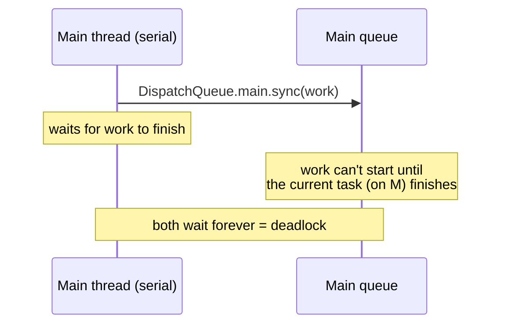

# Multithreading – GCD, Operations & Thread Safety

[⬅ Back to index](../README.md)

Covers: main thread, GCD queues & QoS, sync vs async, deadlocks, DispatchGroup, barriers, semaphores, OperationQueue, locks, race conditions, RunLoop.

---

### 1. Why must UI work happen on the main thread?

<details>
<summary>Answer</summary>

UIKit and SwiftUI aren't thread-safe. The **main thread** runs the main run loop: it handles touch events and lifecycle callbacks, and commits Core Animation transactions for rendering. Updating the UI from a background thread can cause crashes or undefined behaviour (Xcode's **Main Thread Checker** flags it). Blocking the main thread causes **hangs**, and the watchdog kills an app whose main thread stays blocked too long (e.g. during launch).

</details>

### 2. What is GCD (Grand Central Dispatch)?

<details>
<summary>Answer</summary>

GCD is Apple's low-level C-based API for concurrency. You submit **work items (closures) to dispatch queues**, and GCD manages a pool of threads for you.
- **Main queue** – serial, runs on the main thread.
- **Global concurrent queues** – system-provided, with different QoS levels.
- **Custom queues** – `DispatchQueue(label:)` (serial by default) or `attributes: .concurrent`.

```swift
DispatchQueue.global(qos: .userInitiated).async {
    let image = process()
    DispatchQueue.main.async { self.imageView.image = image }
}
```

</details>

### 3. Serial vs concurrent queues? Sync vs async?

<details>
<summary>Answer</summary>

- **Serial queue** – runs **one task at a time**, in FIFO order. Useful for protecting shared state.
- **Concurrent queue** – can run **multiple tasks at the same time** (they start in FIFO order, but may finish in any order).
- **`sync`** – the **caller waits** until the task finishes.
- **`async`** – returns **immediately**; the task runs later.

Serial/concurrent is a property of the **queue**. Sync/async is a property of how you **submit** work.

</details>

### 4. What causes a deadlock with GCD?

<details>
<summary>Answer</summary>

Calling **`sync` on the serial queue you're already running on**: the current task waits for the new one, which can't start until the current one finishes.



```swift
DispatchQueue.main.sync { }   // ❌ called from main thread → deadlock (crash)

let q = DispatchQueue(label: "serial")
q.async { q.sync { } }        // ❌ deadlock
```

Other causes: two threads acquiring locks in opposite order, or waiting on a semaphore on the thread that's supposed to signal it.

</details>

### 5. What are QoS (Quality of Service) classes?

<details>
<summary>Answer</summary>

QoS tells the system how important the work is, which affects CPU scheduling and energy use:
- `.userInteractive` – UI and animations; must finish almost instantly.
- `.userInitiated` – work the user is waiting for (opening a document).
- `.default`
- `.utility` – long-running work with a progress indicator (downloads).
- `.background` – invisible work (backups, prefetching, cleanup).

The system raises the priority of lower-QoS work that higher-QoS work is waiting on (**priority inversion** avoidance).

</details>

### 6. What is DispatchGroup?

<details>
<summary>Answer</summary>

DispatchGroup tracks a set of tasks and notifies you when **all of them finish**:

```swift
let group = DispatchGroup()
group.enter(); api.fetchUser { user = $0; group.leave() }
group.enter(); api.fetchPosts { posts = $0; group.leave() }
group.notify(queue: .main) { render(user, posts) }
```

Every `enter` must be matched by a `leave`. `group.wait()` blocks, so never call it on the main thread. With async/await, use `async let` or a `TaskGroup` instead.

</details>

### 7. What is a dispatch barrier? (Reader-writer problem)

<details>
<summary>Answer</summary>

On a **custom concurrent queue**, a block submitted with `.barrier` waits for all previous tasks to finish, runs **alone**, and only then lets later tasks run. This gives you **concurrent reads with exclusive writes**:

```swift
final class ThreadSafeCache<K: Hashable, V> {
    private var storage = [K: V]()
    private let queue = DispatchQueue(label: "cache", attributes: .concurrent)
    func get(_ k: K) -> V? { queue.sync { storage[k] } }
    func set(_ v: V, for k: K) { queue.async(flags: .barrier) { self.storage[k] = v } }
}
```

Barriers have no effect on global queues. Today, an **actor** is often the simpler solution.

</details>

### 8. What is DispatchSemaphore?

<details>
<summary>Answer</summary>

A counting semaphore that **limits concurrent access** to a resource: `wait()` decrements the count (and blocks when it's 0), and `signal()` increments it. Use it to cap parallel downloads at N. Avoid using it to turn async code into sync code, especially on the main thread (risk of deadlock), and don't use it with Swift concurrency (it blocks threads in the cooperative pool).

</details>

### 9. What are `asyncAfter` and DispatchWorkItem?

<details>
<summary>Answer</summary>

`DispatchQueue.main.asyncAfter(deadline: .now() + 0.3) { }` delays work. A `DispatchWorkItem` can be **cancelled**, which makes it useful for debouncing:

```swift
var searchWork: DispatchWorkItem?
func textChanged(_ q: String) {
    searchWork?.cancel()
    let item = DispatchWorkItem { [weak self] in self?.search(q) }
    searchWork = item
    DispatchQueue.main.asyncAfter(deadline: .now() + 0.3, execute: item)
}
```

</details>

### 10. What is OperationQueue? GCD vs OperationQueue?

<details>
<summary>Answer</summary>

`OperationQueue` is a higher-level, object-oriented API built on GCD. `Operation` objects support:
- **Dependencies** (`op2.addDependency(op1)`), even across queues.
- **Cancellation** (`cancel()`; you check `isCancelled`), plus **KVO-observable state** (`isExecuting`, `isFinished`).
- **`maxConcurrentOperationCount`** to limit concurrency.
- Priorities, and subclassing for reusable or async operations.

| GCD | OperationQueue |
|---|---|
| Lightweight closures | Objects with state |
| No built-in dependencies or cancellation of running blocks | Dependencies, cancellation, max concurrency |
| Fast, simple | More control for complex workflows (e.g. an image download pipeline) |

</details>

### 11. What is a race condition? How do you prevent it?

<details>
<summary>Answer</summary>

A race condition is when multiple threads access **shared mutable state** at the same time and at least one of them writes, so the result depends on timing (corrupted data, crashes such as a dictionary mutated while it's being enumerated).

Prevention:
- A **serial queue** for all access.
- A concurrent queue with **barrier** writes.
- **Locks**: `NSLock`, `os_unfair_lock`, `OSAllocatedUnfairLock`, the `Mutex` from the `Synchronization` framework (iOS 18).
- **Actors** (Swift concurrency): the compiler enforces isolation.
- **Immutability / value types.**

Detect races with the **Thread Sanitizer** (TSan) in the scheme's diagnostics, and with Swift 6's **strict concurrency checking**.

</details>

### 12. What types of locks exist?

<details>
<summary>Answer</summary>

- `NSLock` – a basic mutex.
- `NSRecursiveLock` – can be re-acquired by the same thread.
- `os_unfair_lock` / `OSAllocatedUnfairLock` (iOS 16+) – fast, low-level.
- `Mutex` (iOS 18, `Synchronization` module) – a Swift-native, `Sendable` lock.
- `NSCondition`, `pthread_mutex`, `DispatchSemaphore`.
- `@synchronized` (Objective-C).

Keep critical sections short, and always unlock (`defer { lock.unlock() }`) or use `withLock { }`.

</details>

### 13. What is priority inversion?

<details>
<summary>Answer</summary>

A high-priority task waits on a resource held by a low-priority task, which can't run because medium-priority tasks are using the CPU. GCD/QoS and `os_unfair_lock` handle this with **priority donation** (boosting the holder). Semaphores don't carry ownership information, so they can't donate priority. That's one reason to avoid them for locking.

</details>

### 14. What is a RunLoop?

<details>
<summary>Answer</summary>

A RunLoop is an **event-processing loop** attached to a thread. It waits for input sources (touches, ports) and timers, and sleeps when there's nothing to do. The main thread's run loop runs automatically. Background threads have to run theirs explicitly.

**RunLoop modes:** `.default` and `.tracking` (while scrolling). A `Timer` scheduled in `.default` mode **pauses while the user scrolls**; add it to **`.common`** modes so it keeps firing.

</details>

### 15. Thread vs Queue?

<details>
<summary>Answer</summary>

A **thread** is an OS execution context. A **queue** is an abstraction for scheduling work; GCD maps queues onto a pool of threads. You think in terms of tasks and queues, not threads. The main queue is the only one guaranteed to run on a specific thread (the main thread). Creating many threads by hand is expensive, and GCD can also suffer **thread explosion** if many tasks block.

</details>

### 16. How do you make a singleton thread-safe in Swift?

<details>
<summary>Answer</summary>

`static let shared = Manager()`. Swift initializes global and static constants **lazily and atomically** (it uses `dispatch_once` under the hood), so creating the singleton is thread-safe. The **mutable state inside it** still needs protection (a queue, lock or actor).

</details>

### 17. GCD vs Swift Concurrency – which should you use today?

<details>
<summary>Answer</summary>

For new code, prefer **Swift Concurrency** (async/await, actors, structured tasks). It gives readable sequential code, built-in cancellation, compiler-checked data-race safety in Swift 6, and no thread explosion (it uses a cooperative thread pool). GCD is still useful for legacy code, fine-grained queue control, and C or Objective-C interop. See [Swift Concurrency](05-swift-concurrency.md).

</details>


### 18. Semaphore vs mutex vs lock?

<details>
<summary>Answer</summary>

- **Mutex / lock** (`NSLock`, `os_unfair_lock`, `Mutex`) – **mutual exclusion**: only **one** thread holds it, and **the same thread that locked it must unlock it** (ownership). It protects a critical section.
- **Semaphore** (`DispatchSemaphore(value: n)`) – a **counter** that allows up to **n** concurrent holders. **There's no ownership**: any thread can `signal()`. A semaphore with value 1 behaves like a lock, but without ownership it can't do priority inversion avoidance and it's easier to misuse.
- **Recursive lock** – the same thread can acquire it multiple times.
- **Condition** (`NSCondition`) – lock + wait/signal on a condition.

Use a lock for protecting state, a semaphore for **limiting concurrency** or signaling, and an actor in Swift concurrency code.

</details>

### 19. What are the different ways to achieve concurrency on iOS?

<details>
<summary>Answer</summary>

From lowest to highest level:
1. **POSIX threads (pthreads)** – C API, full manual control. Rarely used directly.
2. **`Thread` (NSThread)** – an object wrapper over a thread. You manage its lifecycle and synchronization.
3. **GCD** – submit closures to queues, and the system manages a thread pool.
4. **`OperationQueue` / `Operation`** – an object-oriented API on top of GCD, with dependencies, cancellation and max concurrency.
5. **Swift Concurrency** – async/await, `Task`, TaskGroup, actors. Structured and compiler-checked. **The recommended approach today.**
6. **Combine / RunLoop-based** async (timers, delegates) for event streams.

Also: `DispatchQueue.concurrentPerform` for parallel loops, and `@synchronized`-style locks for protecting state.

</details>

---

[⬅ Previous: Memory Management](03-memory-management.md) · [⬅ Back to index](../README.md) · [Next: Swift Concurrency ➡](05-swift-concurrency.md)
