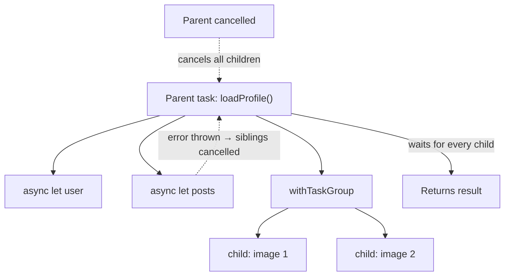
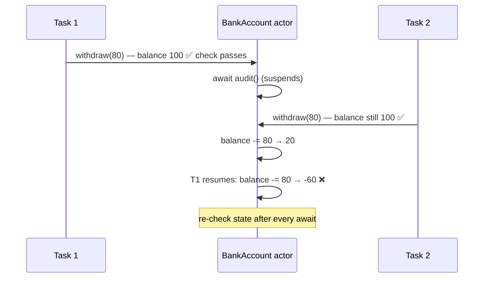

# Swift Concurrency – async/await, Tasks, Actors

[⬅ Back to index](../README.md)

Covers: async/await, Task & structured concurrency, async let, TaskGroup, cancellation, actors, MainActor, Sendable, Swift 6 data-race safety, continuations, AsyncSequence/AsyncStream.

---

## Basics

### 1. What is async/await? What problems does it solve?

<details>
<summary>Answer</summary>

`async` marks a function that can **suspend**; `await` marks the points where it may suspend. Async code then reads like **sequential code**:

```swift
func loadProfile() async throws -> Profile {
    let user = try await api.user()
    let posts = try await api.posts(for: user.id)
    return Profile(user: user, posts: posts)
}
```

Compared with completion handlers, it solves:
- **Callback hell** (nested closures) and its poor readability.
- **Forgetting to call the completion** on some code path (the compiler enforces a return or throw).
- Error handling (`throws` instead of a `Result` passed in each callback).
- Thread-hopping mistakes (actors and `@MainActor`).

While a function is suspended, **its thread is freed** to do other work.

</details>

### 2. How does async/await work under the hood?

<details>
<summary>Answer</summary>

- Async functions are split by the compiler at each `await` into **partial functions (continuations)**. Their state lives in heap-allocated **async frames**, not on the thread stack.
- They run on a **cooperative thread pool** with at most about **one thread per CPU core**. Tasks give up their thread at `await` instead of blocking it, which avoids GCD's thread explosion.
- This is why you must **never block** inside async code (`semaphore.wait()`, `sleep`, synchronous I/O): it starves the pool.
- **Executors** decide where jobs run (the main actor's executor is the main thread).

</details>

### 3. What is a `Task`? How do you call async code from sync code?

<details>
<summary>Answer</summary>

A `Task` is a unit of asynchronous work. It's how you start async work from a synchronous context (button actions, `viewDidLoad`):

```swift
@IBAction func refresh() {
    Task { await viewModel.load() }
}
```

- `Task { }` – **inherits** the current actor (e.g. main) and the priority and task-local values. It's an **unstructured** task.
- `Task.detached { }` – inherits **nothing**. Use it rarely.
- Keep a reference (`let task = Task {...}`) so you can `task.cancel()` it or `await task.value` later.
- In SwiftUI, use the **`.task { }`** modifier: it's automatically cancelled when the view disappears.

</details>

### 4. What is structured concurrency? `async let` vs TaskGroup?

<details>
<summary>Answer</summary>

**Structured concurrency:** child tasks are tied to the scope that created them. The parent **waits** for all its children, **cancellation propagates** down to the children, and **errors propagate** up. No task outlives its scope.



**`async let`** – a **fixed number** of concurrent children:
```swift
async let user = api.user()
async let posts = api.posts()
let profile = try await Profile(user: user, posts: posts)   // run in parallel
```

**TaskGroup** – a **dynamic number** of children:
```swift
let images = try await withThrowingTaskGroup(of: (Int, UIImage).self) { group in
    for (i, url) in urls.enumerated() { group.addTask { (i, try await load(url)) } }
    var result = [Int: UIImage]()
    for try await (i, img) in group { result[i] = img }
    return result
}
```

If one child throws, the group **cancels the remaining children**. Results arrive in **completion order**, not submission order.

</details>

### 5. Structured vs unstructured tasks?

<details>
<summary>Answer</summary>

| Structured (`async let`, TaskGroup) | Unstructured (`Task {}`, `Task.detached {}`) |
|---|---|
| Lifetime bound to the scope | Lives independently |
| Automatic cancellation propagation | Must be cancelled manually |
| Parent waits automatically | You await `task.value` if you need it |

Prefer structured concurrency. Use unstructured tasks only to bridge from sync code or for fire-and-forget work.

</details>

### 6. How does task cancellation work?

<details>
<summary>Answer</summary>

Cancellation is **cooperative**. `task.cancel()` only sets a flag, and your code has to check it:
- `try Task.checkCancellation()` – throws `CancellationError`.
- `Task.isCancelled` – lets you return early.
- `withTaskCancellationHandler(operation:onCancel:)` – reacts immediately (e.g. cancels an underlying request).

Many system APIs (`URLSession` async methods, `Task.sleep`) throw automatically when cancelled. Cancellation propagates to **child tasks**, but not to unstructured `Task {}`s created inside.

</details>

---

## Actors & Isolation

### 7. What is an actor?

<details>
<summary>Answer</summary>

An actor is a **reference type that protects its mutable state from data races**. Only one task at a time can run on the actor (it serializes access), and code outside it has to `await` to reach its state:

```swift
actor ImageCache {
    private var images: [URL: UIImage] = [:]
    func image(for url: URL) -> UIImage? { images[url] }
    func store(_ image: UIImage, for url: URL) { images[url] = image }
}
let img = await cache.image(for: url)
```

The compiler enforces this isolation, so it's like a serial queue that the compiler checks for you. Actors don't support inheritance.

</details>

### 8. What is actor reentrancy?

<details>
<summary>Answer</summary>

When an actor method hits an `await`, the actor can **run other calls** while it's suspended. State can **change across an await**:



```swift
actor BankAccount {
    var balance = 100
    func withdraw(_ amount: Int) async {
        guard balance >= amount else { return }
        await audit()              // suspension point: another withdraw may run here!
        balance -= amount          // ❌ may go negative
    }
}
```

Fix: **re-check the state after each await**, or do the state change synchronously before suspending. For deduplication, store in-flight `Task`s in a dictionary so concurrent callers await the same task.

</details>

### 9. What is `@MainActor`?

<details>
<summary>Answer</summary>

`@MainActor` is a **global actor** that represents the main thread. Annotating a type, function or property with it guarantees the code runs on the main thread, and the compiler enforces it:

```swift
@MainActor
final class ProfileViewModel: ObservableObject {
    @Published var name = ""
    func load() async {
        let user = try? await api.user()   // runs off-main inside api
        name = user?.name ?? ""            // back on main automatically
    }
}
```

UIKit views and view controllers, and SwiftUI `View`, are `@MainActor`. Use `await MainActor.run { }` for a one-off hop. In Swift 6.2 / Xcode 26, new app targets can opt into **main-actor isolation by default** ("approachable concurrency").

</details>

### 10. What is `nonisolated`?

<details>
<summary>Answer</summary>

`nonisolated` marks an actor's (or a `@MainActor` type's) member as **not isolated**, so you can call it synchronously from anywhere. It can only touch immutable or `Sendable` state, e.g. `nonisolated var description: String`, or a hash computed from a `let` id.

</details>

### 11. What is `Sendable`?

<details>
<summary>Answer</summary>

`Sendable` marks types that are **safe to share across concurrency domains** (between tasks or actors):
- Value types whose members are all Sendable (implicitly, for non-public types).
- Actors (always Sendable).
- `final` classes with only immutable (`let`), Sendable properties.
- Classes that protect their state internally (with locks) can declare `@unchecked Sendable`. You're promising the compiler they're safe.
- `@Sendable` closures can't capture mutable state.

The compiler uses `Sendable` to **prove at compile time that there are no data races**.

</details>

### 12. What changed in Swift 6 (strict concurrency / data-race safety)?

<details>
<summary>Answer</summary>

- **Swift 6 language mode** turns data-race safety from warnings into **compile-time errors**: non-Sendable values crossing actor boundaries, unprotected global mutable state, and calls to main-actor APIs from non-isolated code.
- Migrate **incrementally**: set "Strict Concurrency Checking" to minimal → targeted → complete in Swift 5 mode, fix the warnings, then switch to the Swift 6 language mode per module.
- **Region-based isolation** lets the compiler accept non-Sendable values when it can prove they're no longer used after being sent (`sending` parameters).
- Tools: `@preconcurrency import` for libraries that aren't updated yet, `@unchecked Sendable`, and `nonisolated(unsafe)` as escape hatches.
- **Swift 6.2 "approachable concurrency"**: an option for **default `@MainActor` isolation** for app modules, and `nonisolated async` functions now **run on the caller's actor** by default. Use the **`@concurrent`** attribute to explicitly move work off the actor.

</details>

### 13. What are global actors?

<details>
<summary>Answer</summary>

Global actors are actors usable as **attributes** to isolate code spread across many types to a single shared executor. `@MainActor` is the built-in one. You can define your own:

```swift
@globalActor actor DatabaseActor { static let shared = DatabaseActor() }
@DatabaseActor func write() { }
```

</details>

### 14. Actor vs serial DispatchQueue vs lock?

<details>
<summary>Answer</summary>

- **Actor** – compiler-enforced isolation, async access, integrates with structured concurrency. Watch out for reentrancy.
- **Serial queue** – runtime-only safety, so it's easy to forget to use it. Callback- or sync-based.
- **Lock (`Mutex`)** – synchronous and very fast for tiny critical sections. Usable from sync code and safe in concurrency if it's never held across an `await`.

</details>

---

## Bridging & Streams

### 15. How do you convert a completion-handler API to async/await?

<details>
<summary>Answer</summary>

Use **continuations**:

```swift
func fetchUser() async throws -> User {
    try await withCheckedThrowingContinuation { continuation in
        legacyAPI.fetchUser { result in
            continuation.resume(with: result)   // must resume EXACTLY once
        }
    }
}
```

- `withCheckedContinuation` / `withCheckedThrowingContinuation` – detect misuse at runtime (resuming twice crashes; never resuming leaks the task and logs a warning).
- `withUnsafeContinuation` – no checks, slightly faster.
- Xcode can generate async wrappers ("Add Async Wrapper" refactoring).

</details>

### 16. What are AsyncSequence and AsyncStream?

<details>
<summary>Answer</summary>

- **AsyncSequence** – a sequence whose elements arrive **asynchronously**. You iterate with `for try await x in sequence`. Examples: `URLSession.bytes(from:)`, `NotificationCenter.default.notifications(named:)`, and `FileHandle.bytes.lines`.
- **AsyncStream / AsyncThrowingStream** – build your own from callbacks or delegates:

```swift
func locationUpdates() -> AsyncStream<CLLocation> {
    AsyncStream { continuation in
        let delegate = LocationDelegate { continuation.yield($0) }
        continuation.onTermination = { _ in delegate.stop() }
        delegate.start()
    }
}
for await location in locationUpdates() { update(location) }
```

`AsyncStream.makeStream()` returns a `(stream, continuation)` pair. Buffering policies control what happens when the producer is faster than the consumer. For more operators (debounce, merge, combineLatest), use the **swift-async-algorithms** package.

</details>

### 17. Combine vs async/await – when to use which?

<details>
<summary>Answer</summary>

- **async/await** – one-shot asynchronous results (network calls) and linear workflows. It's now the default for new APIs.
- **AsyncSequence** – streams consumed in a loop.
- **Combine** – complex **reactive pipelines** with many operators (combineLatest, debounce on UI input), and existing `@Published`/ObservableObject code.

Apple's newer frameworks lean towards async/await and Observation over Combine. Bridge with `publisher.values` (Combine → AsyncSequence).

</details>

### 18. What are task priorities and TaskLocal?

<details>
<summary>Answer</summary>

- **Priorities:** `Task(priority: .userInitiated)` → `.high`, `.medium`, `.low`, `.utility`, `.background`. The system escalates a task's priority when a higher-priority task awaits it.
- **`@TaskLocal`** – values implicitly propagated to child tasks (like thread-locals for tasks): request IDs, loggers.

</details>

### 19. What is the output / order? (Common question)

<details>
<summary>Answer</summary>

```swift
func test() async {
    print("1")
    Task { print("2") }
    print("3")
    await Task.yield()
    print("4")
}
// Typical output (when called from the main actor): 1, 3, 2, 4
```

The unstructured `Task` is scheduled, not run immediately, so "3" prints before "2". `Task.yield()` gives it a chance to run. The ordering of unstructured tasks **isn't guaranteed**, so don't rely on it in real code.

</details>

### 20. How do you test async code?

<details>
<summary>Answer</summary>

XCTest and Swift Testing both support **`async` test functions**: `func testLoad() async throws { let x = try await sut.load(); XCTAssertEqual(...) }`. Inject protocols for dependencies (mock async APIs). For Combine or callbacks, use expectations (`fulfillment(of:timeout:)`) or `confirmation` in Swift Testing. Control time with an injected clock (`Clock` protocol, a test clock).

</details>

### 21. Common Swift Concurrency mistakes?

<details>
<summary>Answer</summary>

- Blocking inside async code (`semaphore.wait()`, `Thread.sleep`, synchronous file I/O on the cooperative pool).
- Overusing `Task.detached`, or starting tasks without ever cancelling them (leaks, outdated results).
- Ignoring **actor reentrancy** (state changing across `await`).
- Updating the UI from non-main contexts (use `@MainActor`).
- Assuming async functions run in the background. Without `@concurrent` or an actor hop, a nonisolated async function may run on the caller's actor (Swift 6.2 semantics).
- Silencing warnings with `@unchecked Sendable` without making the type actually thread-safe.

</details>

---

[⬅ Previous: GCD & Operations](04-gcd-operations.md) · [⬅ Back to index](../README.md) · [Next: Combine ➡](06-combine.md)
