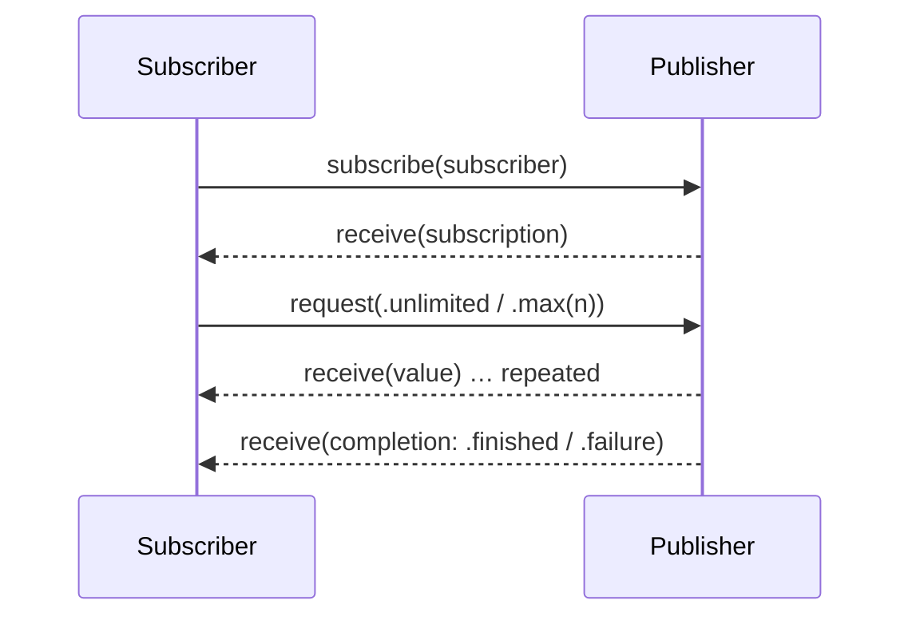

# Combine & Reactive Programming

[⬅ Back to index](../README.md)

Covers: publishers & subscribers, subjects, @Published, operators, schedulers, error handling, memory management, backpressure, Combine vs RxSwift vs async/await.

---

### 1. What is Combine?

<details>
<summary>Answer</summary>

Combine is Apple's **reactive framework** (iOS 13+) for processing values over time. It has three parts:
- **Publisher** – emits values over time and then completes or fails (`Publisher<Output, Failure>`).
- **Operators** – transform values (`map`, `filter`, `debounce`…).
- **Subscriber** – receives values (`sink`, `assign`).

```swift
searchField.textPublisher
    .debounce(for: .milliseconds(300), scheduler: RunLoop.main)
    .removeDuplicates()
    .sink { [weak self] text in self?.search(text) }
    .store(in: &cancellables)
```

</details>

### 2. What is the Publisher–Subscriber lifecycle?

<details>
<summary>Answer</summary>



1. The subscriber calls `subscribe` on the publisher.
2. The publisher sends a **Subscription** to the subscriber.
3. The subscriber **requests** a demand (`.unlimited` or `.max(n)`). That request is the backpressure mechanism.
4. The publisher sends up to that many values (`receive(_:)`).
5. The publisher sends a completion (`.finished` or `.failure(error)`). After that, no more values arrive.

</details>

### 3. What is `AnyCancellable`? Why must you store it?

<details>
<summary>Answer</summary>

`sink` and `assign` return an `AnyCancellable`. When it's **deallocated, the subscription is cancelled**. If you don't store it, the subscription ends immediately. Store it in a `Set<AnyCancellable>` with `.store(in: &cancellables)`, and the subscriptions are cancelled when the owner deinitializes.

</details>

### 4. What are Subjects? PassthroughSubject vs CurrentValueSubject?

<details>
<summary>Answer</summary>

Subjects are publishers that you can **send values into imperatively** (`send(_:)`). They bridge imperative code into Combine.
- **PassthroughSubject** – no stored value; only subscribers that are subscribed at the moment of `send` receive it. Good for **events** (taps, one-time actions).
- **CurrentValueSubject** – holds a **current value** (`.value`), and new subscribers get it immediately. Good for **state**.

</details>

### 5. What is `@Published`?

<details>
<summary>Answer</summary>

A property wrapper (in classes) that creates a publisher for the property, accessed through `$property`. It emits in **`willSet`**, so subscribers get the new value **before** the property has changed. Combined with `ObservableObject`, it drives SwiftUI updates through `objectWillChange`. In iOS 17+, the **Observation framework** (`@Observable`) replaces this pattern for SwiftUI.

</details>

### 6. `map` vs `flatMap` vs `switchToLatest`?

<details>
<summary>Answer</summary>

- `map` – transforms each value.
- `flatMap` – maps each value to a **new publisher** and merges their outputs. Use `maxPublishers: .max(1)` for sequential processing.
- `map { publisher }` + **`switchToLatest()`** – subscribes only to the **latest** inner publisher and cancels the previous one. This is ideal for **search-as-you-type** (old requests are cancelled).

</details>

### 7. `combineLatest` vs `zip` vs `merge`?

<details>
<summary>Answer</summary>

- **`combineLatest`** – emits the latest value from each publisher whenever **any** of them emits (after all have emitted at least once). Used for form validation (`email` + `password` → `isValid`).
- **`zip`** – pairs values **one-to-one** by order (waits for both).
- **`merge`** – interleaves values from publishers of the same type as they arrive.

</details>

### 8. `subscribe(on:)` vs `receive(on:)`?

<details>
<summary>Answer</summary>

- `subscribe(on:)` – the scheduler that runs the **subscription and upstream work** (where the publisher starts).
- `receive(on: DispatchQueue.main)` – the scheduler that **downstream** operators and the subscriber run on. Use it before updating the UI.

</details>

### 9. How do you handle errors in Combine?

<details>
<summary>Answer</summary>

- `catch { _ in Just(defaultValue) }` – replace a failure with another publisher.
- `replaceError(with:)` – a fallback value.
- `retry(3)` – re-subscribe on failure.
- `mapError` – convert error types.
- `setFailureType(to:)` / `eraseToAnyPublisher()` – make types line up.

Important: a failure **terminates** the publisher. To keep a long-lived stream (like UI input) alive, handle errors **inside `flatMap`**, on the inner publisher, so the outer stream never fails.

</details>

### 10. What is `eraseToAnyPublisher()` and why use it?

<details>
<summary>Answer</summary>

Operator chains produce deeply nested generic types (`Publishers.Map<Publishers.Filter<…>>`). `eraseToAnyPublisher()` hides the concrete type behind `AnyPublisher<Output, Failure>`, which gives you clean APIs and hides implementation details.

</details>

### 11. How do retain cycles happen in Combine?

<details>
<summary>Answer</summary>

`self` stores `cancellables`, which hold the subscription, which holds the `sink` closure, which captures `self` strongly. That's a cycle. Use `[weak self]` in `sink`, or `assign(to: &$property)` (iOS 14+), which manages the lifetime itself. Avoid `assign(to: \.prop, on: self)`, because it retains self.

</details>

### 12. What is backpressure in Combine?

<details>
<summary>Answer</summary>

Subscribers control how many values they want through `Subscribers.Demand`. Most built-in subscribers request `.unlimited`. Operators like `buffer`, `debounce`, `throttle` and `collect` help handle fast producers.

</details>

### 13. What are `Future`, `Just`, `Deferred`, `Empty`, `Fail`?

<details>
<summary>Answer</summary>

- `Just(value)` – emits one value, then finishes.
- `Future { promise in }` – wraps a one-shot async operation. ⚠️ It runs **immediately** when created and caches its result. Wrap it in **`Deferred`** to make it lazy (run on subscription).
- `Empty` – finishes without emitting. `Fail(error:)` – fails immediately.

</details>

### 14. Combine vs RxSwift?

<details>
<summary>Answer</summary>

Same concepts: `Observable` ≈ `Publisher`, `BehaviorRelay` ≈ `CurrentValueSubject`, `DisposeBag` ≈ `Set<AnyCancellable>`. Combine is **first-party** (no dependency) and has **typed errors**, but it needs iOS 13+ and has fewer operators. RxSwift has a bigger operator set and RxCocoa bindings, and it's common in older codebases.

</details>

### 15. Is Combine still relevant with async/await and Observation?

<details>
<summary>Answer</summary>

Combine still works and is widely used. It's very good for operator-heavy event pipelines. But Apple's direction is **async/await + AsyncSequence + Observation**: new frameworks rarely expose Combine APIs, and SwiftUI moved from `ObservableObject`/`@Published` to `@Observable`. In interviews, show that you know both and can bridge them (`publisher.values` gives an AsyncSequence).

</details>

### 16. How do you test Combine pipelines?

<details>
<summary>Answer</summary>

Inject schedulers (an `AnySchedulerOf` from a library like combine-schedulers, or `ImmediateScheduler`) to control time. Collect the outputs with `sink` into an array and assert on it with `XCTestExpectation`. You can also convert to async with `.values` and iterate in an async test.

</details>

---

[⬅ Previous: Swift Concurrency](05-swift-concurrency.md) · [⬅ Back to index](../README.md) · [Next: OOP, SOLID & Design Patterns ➡](07-oop-solid-design-patterns.md)
