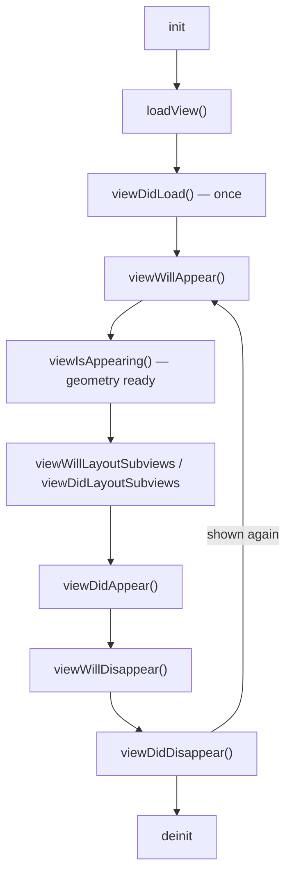
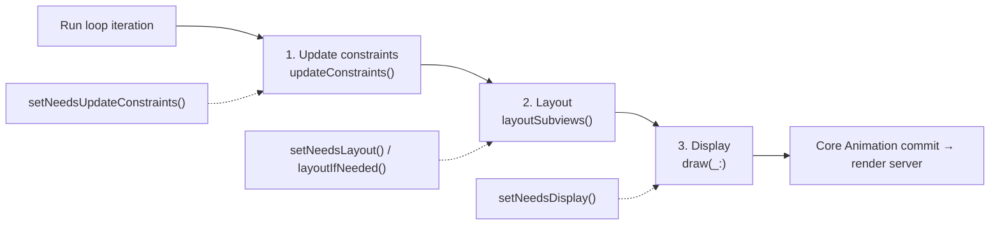
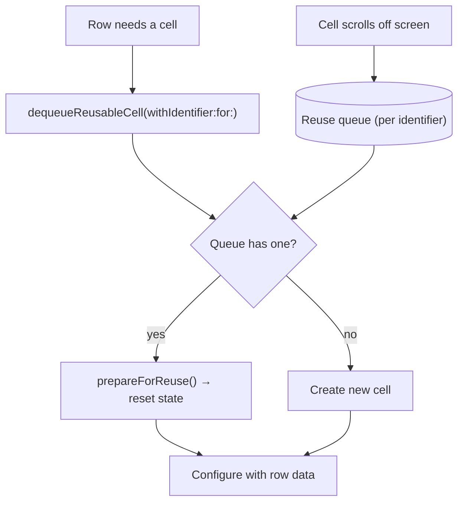

# UIKit – View Controllers, Views, Auto Layout, Lists

[⬅ Back to index](../README.md)

Covers: view controller lifecycle, view lifecycle & rendering, Auto Layout, UITableView/UICollectionView, diffable data sources, navigation, gestures, animations, keyboard handling.

---

## View Controller

### 1. Explain the UIViewController lifecycle.

<details>
<summary>Answer</summary>



1. `init(coder:)` / `init(nibName:bundle:)` – created (from a storyboard or in code).
2. `loadView()` – creates `self.view`. Override it only to provide a custom root view in code (and don't call super then).
3. **`viewDidLoad()`** – called **once** after the view is loaded into memory. One-time setup: subviews, constraints, bindings, initial data loading.
4. **`viewWillAppear(_:)`** – before the view becomes visible, **every time**. Refresh data, start observers, configure the navigation bar.
5. `viewIsAppearing(_:)` (iOS 17, back-deployed to 13) – the view is in the hierarchy with **accurate geometry and traits**. The best place for appearance updates that depend on size.
6. `viewWillLayoutSubviews()` / **`viewDidLayoutSubviews()`** – each layout pass (bounds are final here; may be called many times).
7. **`viewDidAppear(_:)`** – visible on screen. Start animations, analytics and expensive work.
8. **`viewWillDisappear(_:)`** / **`viewDidDisappear(_:)`** – leaving the screen. Stop timers and observers, save state.
9. `deinit` – deallocated (if it's never called, you probably have a leak).

`viewDidUnload` was removed in iOS 6. Views are no longer unloaded on memory warnings.

</details>

### 2. Where should you put code that depends on view size?

<details>
<summary>Answer</summary>

**Not** in `viewDidLoad`: the view hasn't been laid out yet, so its bounds are the storyboard or default size. Use `viewIsAppearing`, `viewDidLayoutSubviews` (beware: it's called many times), `viewWillTransition(to:with:)` for rotation, or `traitCollectionDidChange` / `registerForTraitChanges` (iOS 17) for size class changes. Better still, use Auto Layout so you don't need manual frame math.

</details>

### 3. What are child view controllers / container view controllers?

<details>
<summary>Answer</summary>

Child view controllers let you **compose** screens from smaller, reusable view controllers (which helps avoid Massive View Controllers). Add one in this order:

```swift
addChild(child)
view.addSubview(child.view)   // + constraints
child.didMove(toParent: self)
```

Remove one with `willMove(toParent: nil)` → `view.removeFromSuperview()` → `removeFromParent()`. System containers include `UINavigationController`, `UITabBarController`, `UISplitViewController` and `UIPageViewController`.

</details>

### 4. How do you pass data between view controllers?

<details>
<summary>Answer</summary>

- **Forward:** set properties or inject through the initializer (preferred, since dependencies are explicit). With storyboards, use `prepare(for:sender:)` or `instantiateViewController(identifier:creator:)` (which allows initializer injection).
- **Backward:** delegate protocol, closure callback, or a shared view model/store.
- **App-wide:** NotificationCenter (sparingly), or shared state objects.

With coordinators, the coordinator wires up the data flow between screens.

</details>

### 5. push vs present (modal)?

<details>
<summary>Answer</summary>

- **push** (`navigationController.pushViewController`) – drill-down hierarchical navigation inside a `UINavigationController`, with a back button and swipe-back.
- **present** (`present(_:animated:)`) – modal presentation for a **separate task** (compose, login, picker). Presentation styles: `.pageSheet` (the default card, swipe to dismiss), `.fullScreen`, `.formSheet`, `.overFullScreen`, `.popover`. Sheet detents through `UISheetPresentationController` (`.medium()`, `.large()`, custom).

</details>

---

## Views & Rendering

### 6. Explain the UIView layout & drawing cycle.

<details>
<summary>Answer</summary>

On each run loop iteration, before rendering, UIKit performs three passes:
1. **Update constraints** – `updateConstraints()` (bottom-up). Triggered by `setNeedsUpdateConstraints()`.
2. **Layout** – `layoutSubviews()` (top-down) sets the frames. Triggered by `setNeedsLayout()` (deferred to the next cycle) or `layoutIfNeeded()` (**immediately**, often used inside animation blocks).
3. **Display** – `draw(_:)` for custom drawing. Triggered by `setNeedsDisplay()`.



Then Core Animation commits the layer tree to the **render server**, which composites it on the GPU. You never call `layoutSubviews()` or `draw(_:)` directly.

</details>

### 7. `setNeedsLayout()` vs `layoutIfNeeded()`?

<details>
<summary>Answer</summary>

- `setNeedsLayout()` – marks the view as needing layout. The layout happens on the **next update cycle**, so several changes are batched.
- `layoutIfNeeded()` – forces **any pending layout immediately**, synchronously. It's typically used to animate constraint changes:

```swift
heightConstraint.constant = 200
UIView.animate(withDuration: 0.3) { self.view.layoutIfNeeded() }
```

</details>

### 8. UIView vs CALayer?

<details>
<summary>Answer</summary>

Every UIView is **backed by a CALayer** (`view.layer`). The **layer** handles rendering and animation: content, borders, corner radius, shadows, transforms (Core Animation). The **view** adds event handling (`UIResponder`), Auto Layout, accessibility and gesture recognizers. Use plain CALayers (`CAShapeLayer`, `CAGradientLayer`, `CAEmitterLayer`) for lightweight visuals that don't need touch handling.

</details>

### 9. What is off-screen rendering? How do you avoid it?

<details>
<summary>Answer</summary>

Some effects force the GPU to render into a separate buffer before compositing, which is expensive and causes scrolling jank. Common causes: **`cornerRadius` + `masksToBounds`** on layers with content, **shadows without a `shadowPath`**, masks, group opacity, and `shouldRasterize` misuse.

Fixes: set `layer.shadowPath`, use `cornerCurve`/pre-rounded images, avoid masks in scrolling cells, and check with the **Instruments Core Animation** debug options (Color Off-screen Rendered).

</details>

### 10. How do you create a custom view?

<details>
<summary>Answer</summary>

Subclass `UIView`, implement `init(frame:)` and `init?(coder:)`, add subviews and constraints in a `setup()` method, expose a `configure(with:)` API, override `intrinsicContentSize` if it has a natural size, and use `draw(_:)` or layers for custom drawing. Use `@IBDesignable`/`@IBInspectable` for Interface Builder previews (or `#Preview` with UIKit in Xcode 15+). Make it accessible (labels, traits).

</details>

---

## Auto Layout

### 11. What is Auto Layout? How does it work?

<details>
<summary>Answer</summary>

Auto Layout is a **constraint-based** layout system. You describe relationships (`view.leading = superview.leading + 16`), and the **Cassowary** constraint solver computes the frames. It adapts to screen sizes, rotation, Dynamic Type and localization (RTL, long strings).

Ways to create constraints: **anchors** (`NSLayoutConstraint.activate([...])`), Interface Builder, `UIStackView` (which creates constraints for you), and the Visual Format Language (old). Always set `translatesAutoresizingMaskIntoConstraints = false` on views you constrain in code.

</details>

### 12. What are intrinsic content size, content hugging and compression resistance?

<details>
<summary>Answer</summary>

- **Intrinsic content size** – a view's natural size based on its content (a UILabel's text size, a UIButton's title + insets), so it doesn't need explicit width or height constraints.
- **Content hugging priority** – how much the view **resists growing** beyond its intrinsic size. Higher = "hug my content".
- **Compression resistance priority** – how much the view **resists shrinking** below its intrinsic size. Higher = "don't truncate me".

Example: two labels side by side. Give the one that should stay fully visible a higher compression resistance, and the one that shouldn't stretch a higher hugging priority.

</details>

### 13. What are constraint priorities and ambiguous/unsatisfiable layouts?

<details>
<summary>Answer</summary>

Priorities range from 1 to 1000 (required). Optional constraints (< 1000) are satisfied when possible.
- **Unsatisfiable** – conflicting required constraints. The console logs "Unable to simultaneously satisfy constraints", and UIKit breaks one of them. Fix it by lowering a priority or removing the conflict.
- **Ambiguous** – not enough constraints to determine a unique layout. Debug with the **View Debugger** or `hasAmbiguousLayout` / `exerciseAmbiguityInLayout()`.

Give constraints identifiers to make the logs readable.

</details>

### 14. What is UIStackView? When do you use it?

<details>
<summary>Answer</summary>

A UIStackView arranges its arranged subviews in a row or column (axis, distribution, alignment, spacing) and **generates the constraints for you**. Hiding an arranged subview automatically collapses its space. It's great for forms and toolbars. Avoid deeply nested stack views in hot scrolling cells (they create many constraints).

</details>

### 15. Frame-based layout vs Auto Layout — performance?

<details>
<summary>Answer</summary>

Auto Layout has a solver cost (much improved since iOS 12, roughly linear for independent constraints). Manual frames in `layoutSubviews` are faster, which can matter for very complex, frequently laid-out cells. Most apps use Auto Layout; optimize only after profiling.

</details>

---

## Lists

### 16. How does UITableView cell reuse work?

<details>
<summary>Answer</summary>

Instead of creating a cell for each row, the table view keeps a **reuse queue** per identifier. Cells that scroll off-screen go into the queue, and `dequeueReusableCell(withIdentifier:for:)` returns a recycled cell (or creates one). Memory stays proportional to the **visible** rows.



Pitfalls: **reset all state** in `prepareForReuse()` or during configuration (images, hidden flags, selection), and cancel async image loads so a reused cell doesn't show the wrong image (check the identifier when the image arrives, or cancel the task in `prepareForReuse`).

</details>

### 17. UITableView vs UICollectionView? What is compositional layout?

<details>
<summary>Answer</summary>

- **UITableView** – a single-column vertical list with sections.
- **UICollectionView** – any layout (grids, carousels, custom) through `UICollectionViewLayout`.
- **Compositional Layout** (iOS 13) – builds complex layouts from **items → groups → sections**, with orthogonal scrolling sections (App Store-style carousels) and `UICollectionLayoutListConfiguration` (table-like lists in a collection view).

Modern advice: use a collection view + compositional layout + a diffable data source for new UIKit screens.

</details>

### 18. What is a Diffable Data Source?

<details>
<summary>Answer</summary>

`UITableViewDiffableDataSource` / `UICollectionViewDiffableDataSource` (iOS 13) replace index-based data source methods with **snapshots**:

```swift
var snapshot = NSDiffableDataSourceSnapshot<Section, Item.ID>()
snapshot.appendSections([.main])
snapshot.appendItems(items.map(\.id))
dataSource.apply(snapshot, animatingDifferences: true)
```

The framework **computes the differences** and animates inserts, deletes and moves, which avoids the classic `NSInternalInconsistencyException` ("invalid number of rows"). Items must be `Hashable` (Apple recommends using **identifiers**, then `reconfigureItems` for content updates).

</details>

### 19. How do you implement self-sizing cells?

<details>
<summary>Answer</summary>

Use Auto Layout constraints from the content to all edges of the cell's `contentView` (an unbroken vertical chain), `tableView.rowHeight = UITableView.automaticDimension` (the default), and a reasonable `estimatedRowHeight`. In a collection view, use an estimated dimension in compositional layout (`.estimated(44)`).

</details>

### 20. How do you make lists scroll smoothly?

<details>
<summary>Answer</summary>

Reuse cells, keep `cellForRow` cheap (no synchronous I/O, image decoding or heavy formatting), **decode and downsample images off the main thread**, cache heights and formatted strings, avoid off-screen rendering, use **prefetching** (`UITableViewDataSourcePrefetching`), set opaque backgrounds, and profile with Instruments (Animation Hitches, Time Profiler).

</details>

---

## Interaction & Animation

### 21. What are gesture recognizers?

<details>
<summary>Answer</summary>

Objects that detect gestures (`UITapGestureRecognizer`, `UIPanGestureRecognizer`, `UIPinch…`, `UILongPress…`, `UISwipe…`, `UIRotation…`, `UIScreenEdgePan…`) and send actions. Each one goes through **states**: possible → began → changed → ended / cancelled / failed. Coordinate multiple recognizers with `require(toFail:)` and the `UIGestureRecognizerDelegate` method `shouldRecognizeSimultaneouslyWith`.

</details>

### 22. What animation options exist in UIKit?

<details>
<summary>Answer</summary>

- `UIView.animate(withDuration:)`, including the spring variants.
- **`UIViewPropertyAnimator`** – interruptible, scrubbable and reversible (interactive animations).
- **Core Animation** (`CABasicAnimation`, `CAKeyframeAnimation`) – layer-level control. Remember the model layer vs presentation layer distinction (set the final value).
- `UIView.transition`, custom view controller transitions (`UIViewControllerAnimatedTransitioning`), and **UIKit Dynamics** (physics).

</details>

### 23. How do you handle the keyboard covering text fields?

<details>
<summary>Answer</summary>

- iOS 15+: constrain the content to **`view.keyboardLayoutGuide.topAnchor`**, so it moves automatically.
- Older: observe `UIResponder.keyboardWillShowNotification`, read the keyboard frame, and adjust the scroll view's `contentInset` and `verticalScrollIndicatorInsets`.
- SwiftUI handles the keyboard safe area automatically.
- Dismiss the keyboard with `view.endEditing(true)` or `scrollView.keyboardDismissMode = .interactive`.

</details>

### 24. What are size classes and trait collections?

<details>
<summary>Answer</summary>

A `UITraitCollection` describes the environment: **horizontal/vertical size class** (compact or regular), display scale, user interface style (light/dark), Dynamic Type content size category, layout direction. Adapt the layout when traits change. iOS 17 adds `registerForTraitChanges(_:handler:)` (replacing `traitCollectionDidChange`) and **custom traits**.

</details>

### 25. How do you support Dark Mode and Dynamic Type?

<details>
<summary>Answer</summary>

- **Dark Mode:** semantic system colors (`.label`, `.systemBackground`) or asset-catalog colors with dark variants. Resolve `CGColor`s again on trait changes (layers don't update automatically).
- **Dynamic Type:** `UIFont.preferredFont(forTextStyle:)` + `adjustsFontForContentSizeCategory = true`, multi-line labels (`numberOfLines = 0`), and layouts that adapt at accessibility sizes (switch a stack view's axis). `UIFontMetrics` scales custom fonts.

</details>

### 26. Storyboards vs XIBs vs programmatic UI?

<details>
<summary>Answer</summary>

| Storyboards | XIBs | Programmatic |
|---|---|---|
| Visual flow and segues | Visual, a single reusable view | Full control, code review-friendly |
| **Merge conflicts** in teams, slow with many screens | Fewer conflicts | No merge-conflict pain, easier DI |
| Hard to inject dependencies (improved in iOS 13 with `creator:`) | — | Verbose without helpers |

Many teams use programmatic UIKit or SwiftUI for scalability. A common answer: "XIBs or code for reusable components, and coordinators instead of segues."

</details>

### 27. How do you use SwiftUI in UIKit and vice versa?

<details>
<summary>Answer</summary>

- **SwiftUI in UIKit:** `UIHostingController(rootView:)` as a child view controller, or `UIHostingConfiguration` for collection and table view cells (iOS 16).
- **UIKit in SwiftUI:** `UIViewRepresentable` / `UIViewControllerRepresentable` (`makeUIView`, `updateUIView`, and a `Coordinator` for delegates).

This is the standard approach for incremental migration.

</details>


---

## More UIKit Questions

### 28. How do you add a shadow and rounded corners to the same view?

<details>
<summary>Answer</summary>

```swift
view.layer.cornerRadius = 12
view.layer.cornerCurve = .continuous
view.layer.shadowColor = UIColor.black.cgColor
view.layer.shadowOpacity = 0.15
view.layer.shadowOffset = CGSize(width: 0, height: 4)
view.layer.shadowRadius = 8
view.layer.shadowPath = UIBezierPath(roundedRect: view.bounds, cornerRadius: 12).cgPath  // performance!
```

**The catch:** `masksToBounds = true` (`clipsToBounds`) is needed to clip subviews to the rounded corners, but it **also clips the shadow**. Solutions:
- Use a **container view** for the shadow (`masksToBounds = false`) and an inner content view with `cornerRadius` + `clipsToBounds = true`.
- Or, if the content doesn't need clipping, set only `cornerRadius` + a background color and no masking.

Always set **`shadowPath`** (and update it in `layoutSubviews`). Without it, Core Animation computes the shadow from the layer's alpha with an expensive **off-screen render pass**. `maskedCorners` rounds only specific corners.

</details>

### 29. UIImage vs UIImageView? Aspect fit vs aspect fill?

<details>
<summary>Answer</summary>

- **`UIImage`** – the **image data** (a model object, not a view). `UIImage(named:)` caches the image (good for assets used repeatedly); `UIImage(contentsOfFile:)` doesn't.
- **`UIImageView`** – a **view that displays** a UIImage (and can animate a sequence of images).

`contentMode`:
- **`.scaleAspectFit`** – scales to fit **entirely inside** the bounds, preserving the aspect ratio. There may be **empty bars**.
- **`.scaleAspectFill`** – scales to **fill** the bounds, preserving the aspect ratio. Parts of the image are **cropped**, so set `clipsToBounds = true`.
- **`.scaleToFill`** – stretches and **distorts** the image to fill the bounds.
- `.center`, `.top` and so on – no scaling.

</details>

### 30. What are segues, storyboard IDs, `@IBOutlet` and `@IBAction`?

<details>
<summary>Answer</summary>

- **`@IBOutlet`** – a property connected to a view in Interface Builder (`@IBOutlet weak var titleLabel: UILabel!`). Usually `weak` (the view hierarchy owns the view), though `strong` is fine and Apple's templates use it now.
- **`@IBAction`** – a method called when a control sends an event (`@IBAction func didTapLogin(_ sender: UIButton)`).
- **Segue** – a storyboard-defined transition between view controllers (show/push, present modally, popover, custom, **unwind** segues for going back). Prepare data in `prepare(for:sender:)` and trigger it with `performSegue(withIdentifier:sender:)`.
- **Storyboard ID** – an identifier used to instantiate a view controller in code: `storyboard.instantiateViewController(identifier: "Detail") { coder in DetailVC(coder: coder, item: item) }` (initializer injection, iOS 13+).

Crash to know: a renamed or deleted outlet leaves a stale connection, which causes "this class is not key value coding-compliant for the key X" at runtime.

</details>

### 31. What are the pros and cons of `viewWithTag()`?

<details>
<summary>Answer</summary>

`view.viewWithTag(42)` finds a subview by its integer tag (a recursive search).
- **Pros:** quick for simple prototypes or a few dynamically created views without references.
- **Cons:** **magic numbers** (fragile, no type safety, so you need casts), an O(n) recursive search, duplicate tags return the first match, and it's hard to maintain or refactor. **Prefer outlets, stored properties or custom view subclasses.**

</details>

### 32. How does UIScrollView work?

<details>
<summary>Answer</summary>

- **`contentSize`** – the size of the scrollable content. With Auto Layout, constrain the content to the **`contentLayoutGuide`** (which defines the content size) and the width to the **`frameLayoutGuide`** (for vertical-only scrolling).
- **Scrolling is implemented by changing `bounds.origin`**: `contentOffset` *is* the bounds origin. Subviews keep their frames, and the visible "window" moves over them (that's why bounds can have a non-zero origin).
- **`contentInset` / `adjustedContentInset`** – extra scrollable padding (safe areas, keyboard). `contentInsetAdjustmentBehavior` handles safe areas automatically.
- **Gestures:** UIScrollView owns a **pan gesture recognizer** (and a pinch for **zooming**, with `viewForZooming(in:)`, `minimumZoomScale`/`maximumZoomScale`). `delaysContentTouches` briefly delays touches to decide between scroll and tap. Deceleration and bouncing are animated by the scroll view itself.
- **Delegate:** `scrollViewDidScroll`, `scrollViewWillEndDragging(_:withVelocity:targetContentOffset:)` (custom snapping/paging), `scrollViewDidEndDecelerating`. `isPagingEnabled` gives page snapping.
- Table and collection views are UIScrollView subclasses. **RunLoop** switches to `.tracking` mode while scrolling, so `.default`-mode timers pause.

</details>

### 33. What events can UIControls (buttons, switches) respond to?

<details>
<summary>Answer</summary>

`UIControl.Event`:
- **Touch events:** `.touchDown`, `.touchDownRepeat`, `.touchDragInside/Outside/Enter/Exit`, **`.touchUpInside`** (the standard "tap": the finger lifts inside the control), `.touchUpOutside`, `.touchCancel`.
- **Value events:** **`.valueChanged`** (switches, sliders, segmented controls, date pickers, refresh control).
- **Editing events** (UITextField): `.editingDidBegin`, `.editingChanged`, `.editingDidEnd`, `.editingDidEndOnExit`.
- **`.primaryActionTriggered`** – the control's main action (the button tap, or return in a text field). Used by `UIAction` closures (iOS 14+).

Controls also have **states** (`.normal`, `.highlighted`, `.selected`, `.disabled`) for styling. Modern buttons use `UIButton.Configuration`.

</details>

### 34. What are UIActivityViewController, UIVisualEffectView and UIEditMenuInteraction for?

<details>
<summary>Answer</summary>

- **`UIActivityViewController`** – the system **share sheet** (share text, URLs or images to other apps, AirDrop, copy, save). You can add custom `UIActivity` items and exclude activity types. On iPad it **must be presented as a popover** (set `popoverPresentationController.sourceView`), or the app crashes. SwiftUI: `ShareLink`.
- **`UIVisualEffectView`** – applies **blur** (`UIBlurEffect`) and **vibrancy** effects to content behind it (the frosted-glass look). In iOS 26, **`UIGlassEffect`** provides the Liquid Glass material.
- **`UIEditMenuInteraction`** (iOS 16) – the replacement for the deprecated **`UIMenuController`**. It shows the copy/paste/custom-action edit menu. `UIContextMenuInteraction` gives long-press context menus with previews.

</details>

### 35. Safe area vs layout margins?

<details>
<summary>Answer</summary>

- **Safe area** (`safeAreaLayoutGuide`, `safeAreaInsets`) – the region **not covered** by system UI: the notch/Dynamic Island, status bar, home indicator, navigation and tab bars. Constrain content to it so nothing is hidden. Backgrounds usually extend **beyond** it (edge to edge).
- **Layout margins** (`layoutMarginsGuide`, `directionalLayoutMargins`) – **inner padding** for content inside a view (default ~16–20 pt), adapting to size class and readable width. `readableContentGuide` limits line length for text on wide screens.
- `additionalSafeAreaInsets` on a view controller adds custom inset areas (e.g. for a custom floating bar).

</details>

### 36. What are CGAffineTransform and CADisplayLink used for?

<details>
<summary>Answer</summary>

- **`CGAffineTransform`** – a 2D transformation matrix for **scale, rotate and translate** (and combinations of them) applied to a view: `view.transform = CGAffineTransform(scaleX: 1.2, y: 1.2).rotated(by: .pi / 8)`. It's used in animations (a pop effect, a shake) and doesn't affect Auto Layout (the frame becomes undefined; use bounds/center). Reset it with `.identity`. Use `CATransform3D` for 3D layer transforms.
- **`CADisplayLink`** – a timer **synchronized with the display refresh** (60/120 Hz). It calls your selector before each frame, for custom frame-by-frame animations, games or progress drawing. Set `preferredFrameRateRange` (ProMotion), pause it when not needed, and **invalidate** it (it retains its target, so it's a leak risk).

</details>

### 37. How do you work with styled text (NSAttributedString / AttributedString)?

<details>
<summary>Answer</summary>

- **`NSAttributedString` / `NSMutableAttributedString`** (Foundation, reference type) – a string with **attributes over ranges**: font, color, links, paragraph style, underline, attachments (images). It's used by `UILabel.attributedText` and `UITextView`. Ranges are `NSRange` (UTF-16).
- **`AttributedString`** (iOS 15+, a Swift value type) – type-safe attributes, Swift ranges, **Markdown initialization** (`try AttributedString(markdown: "**Bold** _text_")`), and it works directly with SwiftUI `Text`. iOS 26 adds rich-text editing with `TextEditor`.
- Convert between them with `NSAttributedString(attrString)` / `AttributedString(nsAttrString)`.

</details>

### 38. `viewDidLoad` vs `viewDidAppear` – where should you load remote data?

<details>
<summary>Answer</summary>

- **`viewDidLoad`** runs **once**. Start the **initial data load** here (async), so it doesn't repeat every time the screen appears. Show a loading state immediately.
- **`viewWillAppear`/`viewDidAppear`** run **every time** the screen appears. Use them to **refresh** data that may have changed (after returning from an edit screen), or to start things that only matter while visible (analytics, animations, location).
- Never block either one with synchronous network calls. Usually the view model owns the load, triggered once, with a "refresh if stale" policy on appear.

</details>

### 39. What happens when UIColor/Color values are outside 0–1?

<details>
<summary>Answer</summary>

Since iOS 10, UIColor supports **extended-range sRGB**. Components **below 0 or above 1 are allowed and not clamped**. They represent colors **outside the sRGB gamut**, which wide-color **Display P3** screens can show (more vivid reds and greens). On non-wide-color displays they're clamped when rendered. Prefer `UIColor(displayP3Red:green:blue:alpha:)` and asset catalogs with Display P3 variants. A common bug is passing 0–255 values directly (`UIColor(red: 255, …)`) instead of dividing by 255, which gives out-of-range components.

</details>

---

[⬅ Previous: iOS Fundamentals](08-ios-fundamentals.md) · [⬅ Back to index](../README.md) · [Next: SwiftUI ➡](10-swiftui.md)
