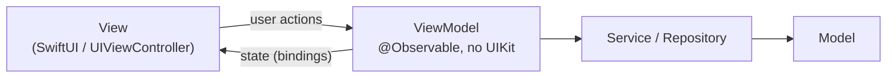
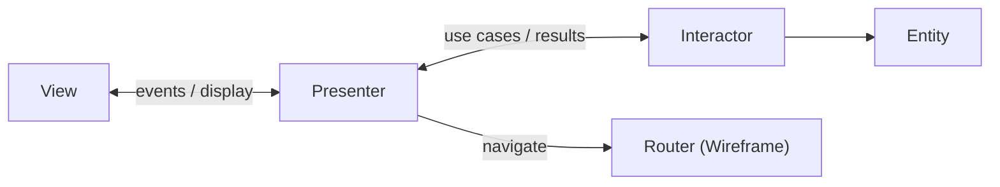
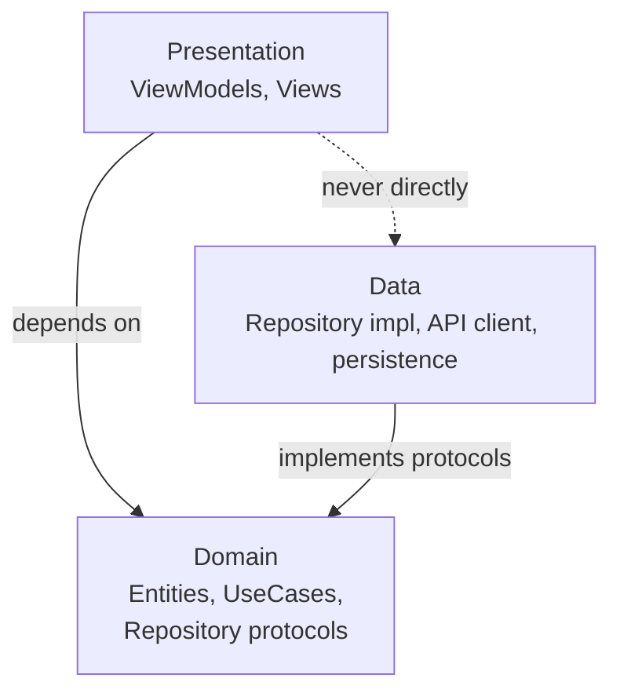
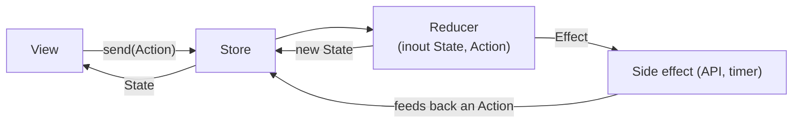
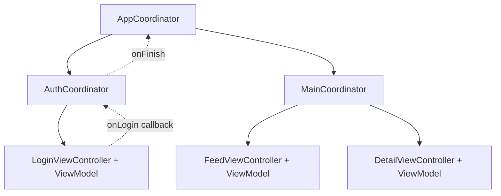

# App Architecture

[⬅ Back to index](../README.md)

Covers: MVC, MVP, MVVM, VIPER, Clean Architecture, TCA, Coordinators, unidirectional data flow, choosing an architecture, modularization.

---

### 1. Why does architecture matter in iOS apps?

<details>
<summary>Answer</summary>

It gives **separation of concerns**, **testability** (logic without UI), **maintainability** as the app and team grow, parallel development, and consistency. Without it you get Massive View Controllers: a 2,000-line VC that does networking, parsing, formatting and navigation.

</details>

### 2. Explain Apple's MVC. What's wrong with it?

<details>
<summary>Answer</summary>

- **Model** – data and business logic.
- **View** – UI elements (UIView).
- **Controller** – mediates between them.

In UIKit, the `UIViewController` is **tightly coupled to its view** (it owns the lifecycle and the outlets), so View and Controller blur together into "**Massive View Controller**". Everything ends up in the VC, it's hard to unit test (it needs a UIKit lifecycle), and it's hard to reuse.

</details>

### 3. What is MVVM? How do you bind the ViewModel to the View?

<details>
<summary>Answer</summary>

**Model–View–ViewModel**: the **ViewModel** holds the presentation state and logic. It turns models into display-ready data (formatted strings, `isLoading`), handles user actions, and calls services. It **doesn't import UIKit** and doesn't reference the view, so it's unit-testable.



Binding options:
- **SwiftUI:** `@Observable` / `ObservableObject` (automatic).
- **UIKit:** Combine (`@Published` + `sink`), closures (`var onStateChange: ((State) -> Void)?`), a custom `Observable<T>` box, RxSwift, or delegates.

```swift
@MainActor @Observable
final class ProfileViewModel {
    enum State { case idle, loading, loaded(Profile), failed(String) }
    private(set) var state: State = .idle
    private let service: ProfileService
    init(service: ProfileService) { self.service = service }
    func load() async {
        state = .loading
        do { state = .loaded(try await service.fetch()) }
        catch { state = .failed(error.localizedDescription) }
    }
}
```

</details>

### 4. MVC vs MVP vs MVVM?

<details>
<summary>Answer</summary>

| | MVC | MVP | MVVM |
|---|---|---|---|
| Logic lives in | Controller (VC) | **Presenter** | **ViewModel** |
| View ↔ logic | VC owns the view | Presenter calls the view through a **protocol** (`view.showName()`) | View **observes/binds** to ViewModel state |
| Reference to the view | Yes | Yes (weak, protocol) | **No** |
| Testability | Low | High | High |
| Boilerplate | Low | Medium (view protocols) | Medium (binding) |

</details>

### 5. What is VIPER?

<details>
<summary>Answer</summary>

VIPER splits each module (screen) into:
- **V**iew – displays what the presenter tells it and forwards user input.
- **I**nteractor – business logic and use cases; talks to services.
- **P**resenter – presentation logic; prepares data for the view and coordinates the parts.
- **E**ntity – plain data models.
- **R**outer (Wireframe) – navigation and module assembly.



Pros: a very clear separation, highly testable, scales to big teams.
Cons: **lots of boilerplate** (5+ files per screen and many protocols), and overkill for simple screens. It's less popular now with SwiftUI.

</details>

### 6. What is Clean Architecture in iOS?

<details>
<summary>Answer</summary>

Layers with the **dependency rule** (dependencies point **inward**):
- **Domain** (innermost) – entities, **use cases**, repository **protocols**. Pure Swift, with no UIKit or networking.
- **Data** – repository implementations, API clients, persistence, DTOs and mappers.
- **Presentation** – view models or presenters, and views.



The data layer implements the domain's protocols (**Dependency Inversion**). You get testable business logic, swappable data sources and framework independence, at the cost of more layers and mapping code. It's often combined with MVVM and Coordinators ("Clean MVVM + C").

</details>

### 7. What is The Composable Architecture (TCA)?

<details>
<summary>Answer</summary>

A Point-Free library implementing **unidirectional data flow** (inspired by Redux/Elm):
- **State** – the feature's data (a struct).
- **Action** – everything that can happen (user events, effect responses).
- **Reducer** – a pure function `(inout State, Action) -> Effect<Action>`.
- **Effects** – side effects (API calls) that feed actions back into the system.
- **Store** – runs the feature. **Dependencies** are managed with `@Dependency`.



Pros: predictable state, excellent **exhaustive testing** (`TestStore` checks every state change), composition of features. Cons: a learning curve, a third-party dependency, and macro and compile-time overhead.

</details>

### 8. What is unidirectional data flow (UDF)?

<details>
<summary>Answer</summary>

**State flows down to the view; actions/events flow up.** The view renders the state and sends actions; a single place (a reducer, view model or store) mutates the state. It gives predictability, easy debugging (log every action), and no conflicting two-way updates. It's used by TCA, Redux-like stores, MVI, and SwiftUI's own state model.

</details>

### 9. How does the Coordinator pattern fit into the architecture?

<details>
<summary>Answer</summary>

Coordinators **own navigation**, so view controllers and view models don't know about the next screen. They create screens (with dependency injection), handle deep links, and manage flows (onboarding, auth, checkout). Combined with MVVM, this is often called **MVVM-C**. In SwiftUI, a `Router`/`Coordinator` `@Observable` object owns the `NavigationPath`. See [Design Patterns Q14](07-oop-solid-design-patterns.md).



</details>

### 10. How do you choose an architecture?

<details>
<summary>Answer</summary>

Consider:
- **Team size and experience** (VIPER or TCA for large teams with strict boundaries).
- **App complexity** (a small app → MVVM, or MV with SwiftUI).
- **UI framework** (SwiftUI fits MVVM/TCA/MV; UIKit fits MVVM-C or VIPER).
- Testing needs, and the existing codebase (migrate incrementally).

A good answer: "There's no single best architecture. I default to MVVM + Coordinators/Router + a repository layer, add use cases when business logic is shared, and keep things consistent across the team."

</details>

### 11. What is the Repository + Service layer?

<details>
<summary>Answer</summary>

- **API Client / Network service** – builds requests and decodes responses.
- **Persistence store** – Core Data, SwiftData, files.
- **Repository** – the single access point that combines them (cache-first policy, mapping DTOs to domain models) and exposes protocols to the rest of the app.

ViewModels depend on repository protocols, which makes them easy to mock.

</details>

### 12. How do you modularize an iOS app?

<details>
<summary>Answer</summary>

Split the code into **Swift Packages** (SPM local packages) or frameworks:
- `Core` (networking, persistence, utilities), `DesignSystem` (UI components), `Models`.
- **Feature modules** (`ProfileFeature`, `CheckoutFeature`) that **don't depend on each other**. They communicate through interfaces or the app's coordinator.
- **Interface/implementation split** for heavy modules.

Benefits: faster incremental builds, clear ownership, enforced access control (`internal`/`package`), reusable modules (e.g. shared with extensions), isolated feature testing and demo apps. Watch out for **launch time** with many dynamic frameworks (prefer static linking or mergeable libraries).

</details>

### 13. How do you handle state across screens / global state?

<details>
<summary>Answer</summary>

Shared `@Observable` stores or services (session, cart) injected through initializers or the environment, a single app store (TCA/Redux), or persistence as the source of truth. Avoid singletons with mutable state, and NotificationCenter as the main data flow.

</details>

### 14. Explain your current project's architecture. (How to answer)

<details>
<summary>Answer</summary>

Structure your answer:
1. **UI:** "SwiftUI with some UIKit (UIHostingController/Representable)".
2. **Pattern:** "MVVM with `@Observable` view models, coordinator/router navigation".
3. **Layers:** "Repositories over an async/await API client and a SwiftData/Core Data cache".
4. **DI:** "constructor injection with a composition root".
5. **Modules:** "SPM feature packages".
6. **Concurrency:** "Swift 6 strict concurrency, `@MainActor` view models".
7. **Testing:** "unit tests on view models with mocked repositories, UI tests for critical flows".

End with **one trade-off** you made and **one improvement** you'd like to make.

</details>

### 15. What are the drawbacks of over-architecting?

<details>
<summary>Answer</summary>

Boilerplate (protocols with a single implementation, pass-through use cases, VIPER files for trivial screens), slower onboarding and delivery, and indirection that makes the code harder to read. Add architecture where it pays off: testing, reuse, team boundaries.

</details>


### 16. Software architecture vs software design? Class vs object?

<details>
<summary>Answer</summary>

- **Software architecture** – the **high-level structure** of the whole system: layers, modules, how data flows, technology choices (MVVM + Coordinators, Clean layers, modularization, offline-first). These decisions are expensive to change.
- **Software design** – the **lower-level** structure inside components: classes, protocols, design patterns, APIs and algorithms.
- **Class vs object:** a **class** (or struct type) is the **blueprint** that defines properties and behaviour. An **object/instance** is a concrete **realization** of that blueprint in memory, with its own state.

</details>

---

[⬅ Previous: SwiftUI](10-swiftui.md) · [⬅ Back to index](../README.md) · [Next: Dependency Injection & SPM ➡](12-dependency-injection-modularization.md)
