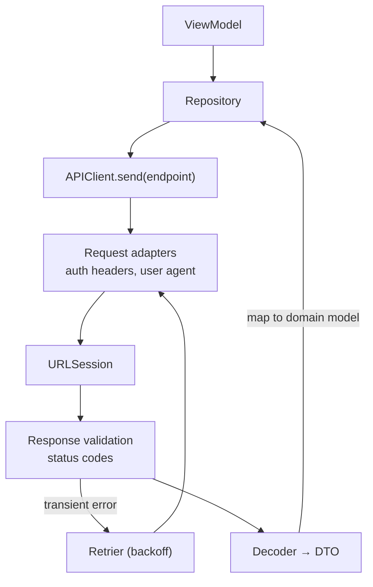
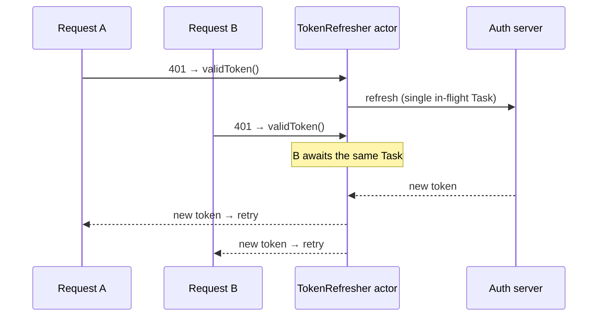

# Networking

[⬅ Back to index](../README.md)

Covers: HTTP/REST basics, URLSession, async networking, building a network layer, Codable decoding, error handling, auth & token refresh, caching, background transfers, WebSockets, image loading, ATS & pinning.

---

### 1. What are the HTTP methods and status codes you should know?

<details>
<summary>Answer</summary>

**Methods:** `GET` (read), `POST` (create), `PUT` (replace), `PATCH` (partial update), `DELETE`. GET, PUT and DELETE are **idempotent**; POST isn't.

**Status codes:** 2xx success (200, 201, 204), 3xx redirect (301, 304 Not Modified), 4xx client error (400, **401 unauthenticated**, **403 forbidden**, 404, 409, **429 rate-limited**), 5xx server error (500, 502, 503).

</details>

### 2. What is URLSession? What are its task types and configurations?

<details>
<summary>Answer</summary>

`URLSession` is Apple's networking API.

**Tasks:**
- `dataTask` – data in memory (JSON APIs).
- `uploadTask` – uploads a file or data. Supports background sessions.
- `downloadTask` – downloads to a file. Supports background sessions and resuming.
- `webSocketTask` – WebSockets.
- `streamTask` – TCP streams.

**Configurations:**
- `.default` – disk cache, cookies, credentials.
- `.ephemeral` – nothing stored on disk (private browsing).
- `.background(withIdentifier:)` – transfers continue **while the app is suspended or terminated**; the system handles them.

Use `URLSession.shared` for simple requests. Create a **custom session** for custom config (timeouts, headers, `waitsForConnectivity`, delegates). Reuse sessions; don't create one per request.

</details>

### 3. How do you make a network request with async/await?

<details>
<summary>Answer</summary>

```swift
func fetchUser(id: Int) async throws -> User {
    var request = URLRequest(url: baseURL.appending(path: "users/\(id)"))
    request.setValue("application/json", forHTTPHeaderField: "Accept")
    let (data, response) = try await session.data(for: request)
    guard let http = response as? HTTPURLResponse else { throw NetworkError.invalidResponse }
    guard (200..<300).contains(http.statusCode) else { throw NetworkError.http(http.statusCode, data) }
    return try decoder.decode(User.self, from: data)
}
```

The async `URLSession` methods (iOS 15) **support cancellation**: cancelling the Task cancels the request. Note that URLSession **doesn't throw for 4xx/5xx**; you must check the status code yourself.

</details>

### 4. How do you design a scalable network layer?

<details>
<summary>Answer</summary>



```swift
protocol Endpoint {
    var path: String { get }
    var method: HTTPMethod { get }
    var queryItems: [URLQueryItem] { get }
    var body: Encodable? { get }
}

protocol APIClient { func send<T: Decodable>(_ endpoint: Endpoint, as: T.Type) async throws -> T }

final class URLSessionAPIClient: APIClient {
    private let session: URLSession; private let baseURL: URL; private let decoder: JSONDecoder
    private let interceptors: [RequestInterceptor]   // auth headers, logging
    func send<T: Decodable>(_ endpoint: Endpoint, as: T.Type) async throws -> T { /* build, adapt, send, validate, decode */ }
}
```

Key points: **endpoints as types**, a generic `send`, centralized **request adaptation** (auth headers, user agent), **response validation**, error mapping, retry policy, logging (debug only), protocol-based injection for testing, and **DTO → domain mapping** in repositories.

</details>

### 5. How do you parse JSON with Codable? How do you handle tricky JSON?

<details>
<summary>Answer</summary>

`JSONDecoder().decode(User.self, from: data)`. Configure it with:
- `keyDecodingStrategy = .convertFromSnakeCase`, `dateDecodingStrategy = .iso8601` (or a custom `DateFormatter`).
- `CodingKeys` to rename fields.
- A custom `init(from:)` for **nested containers** (`nestedContainer(keyedBy:forKey:)`), **default values** (`decodeIfPresent ?? default`), **polymorphic** payloads (decode a `type` field first, then decode the matching subtype), and lossy arrays (skip invalid elements).
- Make optional fields optional, so a missing key doesn't fail the whole response.

Decode **off the main thread** for large payloads.

</details>

### 6. How do you handle network errors properly?

<details>
<summary>Answer</summary>

Define a domain error type:

```swift
enum NetworkError: Error {
    case offline, timeout, unauthorized, server(code: Int), decoding(Error), cancelled, unknown(Error)
}
```

Map `URLError` codes (`.notConnectedToInternet`, `.timedOut`, `.cancelled`), HTTP status codes and `DecodingError` to it. Show **user-friendly messages** in the view model, retry only **transient** errors (timeouts, 5xx, 429) with exponential backoff, ignore cancellations, and log the details for diagnostics.

</details>

### 7. How do you implement authentication and token refresh?

<details>
<summary>Answer</summary>



- Store tokens in the **Keychain**, never in UserDefaults.
- Add `Authorization: Bearer <token>` in a request adapter or interceptor.
- On **401**: refresh the token **once**, even if several requests fail at the same time. Use an **actor** that holds a single in-flight refresh task, so concurrent callers await the same refresh:

```swift
actor TokenRefresher {
    private var refreshTask: Task<String, Error>?
    func validToken(refresh: @escaping @Sendable () async throws -> String) async throws -> String {
        if let task = refreshTask { return try await task.value }
        let task = Task { try await refresh() }
        refreshTask = task
        defer { refreshTask = nil }
        return try await task.value
    }
}
```

- Retry the original request with the new token. If the refresh fails, **log out**.
- For login with third parties, use **OAuth 2 + PKCE** through `ASWebAuthenticationSession`, and consider **passkeys**.

</details>

### 8. How does caching work with URLSession?

<details>
<summary>Answer</summary>

`URLCache` (memory + disk) follows HTTP cache headers (`Cache-Control`, `ETag` / `If-None-Match` → **304**). Set the policy per request (`.useProtocolCachePolicy`, `.returnCacheDataElseLoad`, `.reloadIgnoringLocalCacheData`) and configure the size (`URLCache(memoryCapacity:diskCapacity:)`). For offline-first apps, persist the data in **Core Data or SwiftData** instead of relying on the HTTP cache.

</details>

### 9. How do background uploads and downloads work?

<details>
<summary>Answer</summary>

Use a `URLSessionConfiguration.background(withIdentifier:)` session with **file-based** upload or download tasks and a **delegate** (completion handlers aren't supported). The system performs the transfer **even if the app is suspended or killed**. When it finishes, the app is relaunched in the background and `application(_:handleEventsForBackgroundURLSession:completionHandler:)` is called. Recreate the session with the same identifier, handle the delegate callbacks, then call the stored completion handler. Options: `isDiscretionary` (the system picks the best time), `sessionSendsLaunchEvents`.

</details>

### 10. How do you monitor network connectivity?

<details>
<summary>Answer</summary>

Use `NWPathMonitor` (the Network framework): `pathUpdateHandler` reports `path.status == .satisfied`, `isExpensive` (cellular or hotspot) and `isConstrained` (Low Data Mode). Expose it as an AsyncStream or an `@Observable` property. Also set `waitsForConnectivity = true` on the session, so requests wait for connectivity instead of failing immediately. Don't use reachability as a check *before* making requests; just handle the failures.

</details>

### 11. WebSockets vs polling vs push notifications?

<details>
<summary>Answer</summary>

- **WebSocket** (`URLSessionWebSocketTask`) – full-duplex, real-time (chat, live updates) while in the foreground. Handle ping/pong, reconnect with backoff, and close it in the background.
- **Polling** – simple but wasteful.
- **Server-Sent Events** – one-way streaming (can be consumed with `URLSession.bytes` + line parsing).
- **APNs push** – wakes and notifies the app when it isn't running. Battery-efficient.

</details>

### 12. How do you load images efficiently from the network?

<details>
<summary>Answer</summary>

- Use `AsyncImage` (SwiftUI, basic, no persistent cache) or libraries like **Kingfisher**, **Nuke** or SDWebImage.
- Or build your own: an **NSCache** memory cache + a disk cache, request deduplication (an actor holding in-flight tasks), **downsampling** to the display size with `CGImageSourceCreateThumbnailAtIndex` (huge memory savings), decoding off the main thread (`UIImage.preparingThumbnail(of:)`, `byPreparingForDisplay()`), cancellation when cells are reused, and prefetching.

</details>

### 13. What is App Transport Security (ATS)?

<details>
<summary>Answer</summary>

ATS requires **HTTPS with TLS 1.2+ and forward secrecy** by default for app connections. Exceptions (`NSAllowsArbitraryLoads`, `NSExceptionDomains`) are set in Info.plist and must be justified in App Review. Keep exceptions as narrow as possible (specific domains only).

</details>

### 14. What is SSL/certificate pinning? How do you implement it?

<details>
<summary>Answer</summary>

Pinning makes the app trust **only specific certificates or public keys**, which prevents man-in-the-middle attacks even with a compromised or user-installed CA. Implement it in `urlSession(_:didReceive challenge:completionHandler:)` by comparing the server's public key hash with the pinned hashes, or declaratively with **`NSPinnedDomains`** in Info.plist (iOS 14+). Pin **public keys** (they survive certificate renewal), include **backup pins**, and plan for rotation, or users get locked out.

</details>

### 15. REST vs GraphQL on iOS?

<details>
<summary>Answer</summary>

REST: multiple endpoints, simple, cache-friendly, but it can over- or under-fetch. GraphQL: a single endpoint where the client asks for exactly the fields it needs, with a typed schema and code generation (**Apollo iOS**). It's good for complex, nested UIs, but caching and tooling are more involved.

</details>

### 16. How do you test networking code?

<details>
<summary>Answer</summary>

- Inject an `APIClient` protocol and use mocks in view model tests.
- To test the client itself, use a **`URLProtocol` subclass** registered in a custom `URLSessionConfiguration` (`protocolClasses`) to return canned responses, and assert on the requests (URL, headers, body). This needs no real network.
- Keep JSON **fixtures** in the test bundle to test decoding.

</details>

### 17. How do you handle pagination?

<details>
<summary>Answer</summary>

Prefer **cursor-based** pagination (`?after=<cursor>`) over offset-based (`?page=3`), because it's stable when items are inserted. In the view model, track `nextCursor`, `isLoading` and `hasMore`. Trigger the next page when the last few rows appear (`onAppear` of the last item, or a prefetching data source), and deduplicate items by ID.

</details>


---

## More Networking Questions

### 18. TCP vs UDP? What are sockets? REST vs SOAP?

<details>
<summary>Answer</summary>

- **TCP** – connection-oriented, **reliable and ordered** (handshake, retransmission). Used by HTTP/1.1, HTTP/2, WebSockets.
- **UDP** – connectionless, **no delivery or order guarantees**, low latency. Used for real-time audio/video (WebRTC), DNS, games, and **QUIC/HTTP/3** (URLSession supports HTTP/3).
- **Sockets** – endpoints (IP + port) for network communication. On iOS: the **Network framework** (`NWConnection`, `NWListener`) is the modern API; `URLSessionStreamTask`, and the legacy `CFStream`/`NSStream`, also exist.
- **REST** – resource-oriented, HTTP verbs, usually JSON, stateless and lightweight. **SOAP** – an XML-based protocol with a strict contract (WSDL) and envelope. It's verbose and mostly found in legacy enterprise systems.

</details>

### 19. What are the pros and cons of JSON? What alternatives exist?

<details>
<summary>Answer</summary>

**JSON pros:** human-readable, universal support (Codable), schema-less flexibility, easy debugging.
**Cons:** verbose (larger payloads), slower to parse than binary formats, no built-in schema or type guarantees (runtime decoding errors), and no native date or binary types (dates need conventions, binary data needs Base64).

**Alternatives:** **Protocol Buffers** (binary, schema, smaller and faster, backward compatible; `swift-protobuf`, used with gRPC), FlatBuffers (zero-copy), MessagePack, and Property Lists (Apple-native). Use JSON by default, and binary formats when size and performance matter.

</details>

### 20. How do you upload files (multipart) with URLSession?

<details>
<summary>Answer</summary>

Multipart/form-data sends files and fields in one request, separated by a **boundary**:

```swift
let boundary = "Boundary-\(UUID().uuidString)"
var request = URLRequest(url: uploadURL); request.httpMethod = "POST"
request.setValue("multipart/form-data; boundary=\(boundary)", forHTTPHeaderField: "Content-Type")

var body = Data()
body.append("--\(boundary)\r\n".data(using: .utf8)!)
body.append("Content-Disposition: form-data; name=\"file\"; filename=\"photo.jpg\"\r\n".data(using: .utf8)!)
body.append("Content-Type: image/jpeg\r\n\r\n".data(using: .utf8)!)
body.append(imageData)
body.append("\r\n--\(boundary)--\r\n".data(using: .utf8)!)

let (data, response) = try await URLSession.shared.upload(for: request, from: body)
```

For **large files**, write the body to a temporary file and use `uploadTask(with:fromFile:)` (required for **background sessions**), which avoids holding everything in memory. Track progress with the delegate's `didSendBodyData` or `task.progress`. Consider presigned URLs (uploading directly to S3/GCS) or resumable uploads for big media.

</details>

---

[⬅ Previous: DI & SPM](12-dependency-injection-modularization.md) · [⬅ Back to index](../README.md) · [Next: Data Persistence ➡](14-data-persistence.md)
