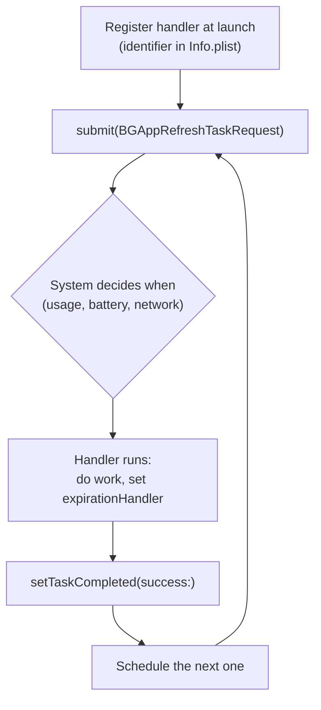
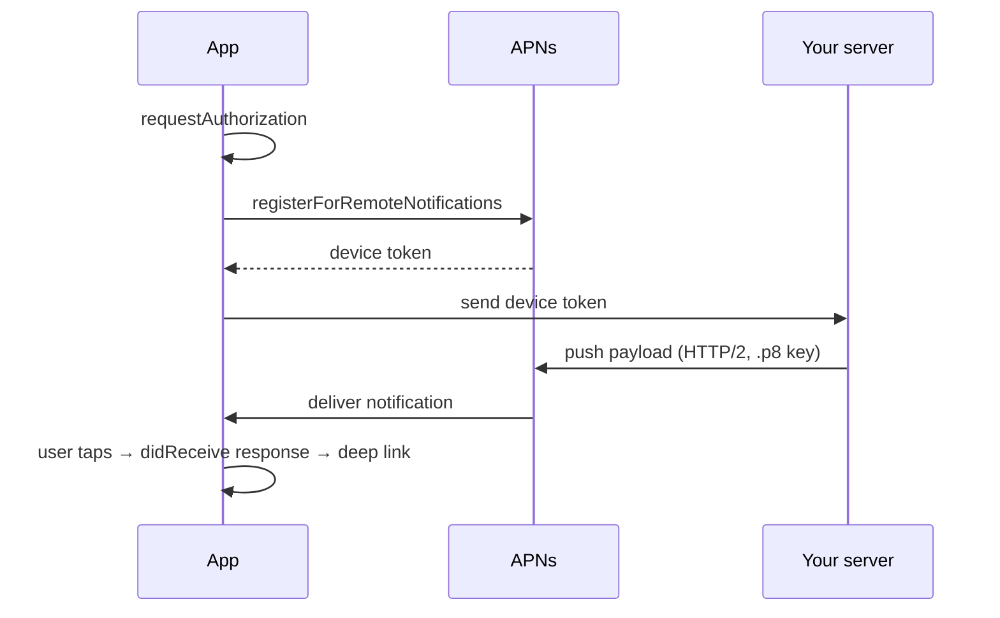

# Background Execution & Notifications

[⬅ Back to index](../README.md)

Covers: background execution limits, background modes, BGTaskScheduler, background URLSession, push notifications (APNs), silent pushes, notification extensions, local notifications, Live Activities & widgets.

---

## Background Execution

### 1. What can an iOS app do in the background?

<details>
<summary>Answer</summary>

By default, an app is **suspended shortly after entering the background**. Ways to get background time:
- **`beginBackgroundTask(withName:expirationHandler:)`** – finish a short task (e.g. saving or an upload) for **up to ~30 seconds**. Always call `endBackgroundTask`.
- **Background modes** (capabilities): audio playback, location updates, VoIP (with CallKit + PushKit), Bluetooth (central/peripheral), external accessory, remote notifications, background fetch, background processing.
- **BGTaskScheduler** – deferred refresh and processing tasks scheduled by the system.
- **Background URLSession** – uploads and downloads handled by the system.
- **Silent push notifications** – wake the app briefly to fetch data.

iOS is **much stricter** than Android: there's no general-purpose long-running background service.

</details>

### 2. What is BGTaskScheduler? Refresh vs processing tasks?

<details>
<summary>Answer</summary>

The `BackgroundTasks` framework (iOS 13) lets the system run deferred work at a good time (based on usage patterns, battery and network):
- **`BGAppRefreshTask`** – short (~30 s) work to refresh content (fetch the latest feed).
- **`BGProcessingTask`** – longer, deferrable maintenance (DB cleanup, ML training). It can require external power or network, and usually runs while the device is charging and idle.
- **`BGContinuedProcessingTask`** (iOS 26) – continues a **user-initiated** task (e.g. an export) after the app is backgrounded, with system progress UI.



Steps:
1. Add the task identifiers to Info.plist (`BGTaskSchedulerPermittedIdentifiers`).
2. **Register the handlers at launch** (before launch finishes).
3. **Submit a request** with `earliestBeginDate`.
4. In the handler, do the work, set an `expirationHandler`, call `setTaskCompleted(success:)`, and schedule the next one.

The system decides **when** (or whether) the task runs; it's not guaranteed. In Xcode you can simulate a launch with the debugger command `e -l objc -- (void)[[BGTaskScheduler sharedScheduler] _simulateLaunchForTaskWithIdentifier:@"id"]`.

</details>

### 3. How does continuous location tracking work in the background?

<details>
<summary>Answer</summary>

Enable the "Location updates" background mode, get **Always** authorization (or When In Use + `allowsBackgroundLocationUpdates` while the app was started in the foreground; the blue indicator is shown), and use `CLLocationUpdate.liveUpdates()` (iOS 17) or `CLLocationManager`. For battery efficiency, prefer **significant-location changes**, **region monitoring / geofencing** (`CLMonitor` in iOS 17) or **visits monitoring**. These can relaunch a terminated app.

</details>

### 4. What happens to timers and network requests when the app goes to the background?

<details>
<summary>Answer</summary>

Once the app is **suspended**, timers stop firing and in-flight `dataTask`s may fail or be paused. Save state in `sceneDidEnterBackground`, use `beginBackgroundTask` for short completion, and use background URLSession for transfers that must finish.

</details>

---

## Push Notifications

### 5. How do remote push notifications work (APNs flow)?

<details>
<summary>Answer</summary>



1. The app asks for permission: `UNUserNotificationCenter.current().requestAuthorization(options: [.alert, .sound, .badge])`.
2. It registers with APNs: `UIApplication.shared.registerForRemoteNotifications()`.
3. iOS returns a **device token** in `didRegisterForRemoteNotificationsWithDeviceToken`. The app **sends it to your server** (tokens can change, so send it on each launch).
4. Your server sends the payload to **APNs** (HTTP/2, authenticated with a **.p8 token key** or a certificate), targeting that device token, with headers such as `apns-push-type` and `apns-priority`.
5. APNs delivers it to the device. The system displays it, or wakes the app for silent pushes.
6. The user taps it, and the app handles `userNotificationCenter(_:didReceive:withCompletionHandler:)` (deep link to the content).

The payload limit is **4 KB**. Use separate sandbox and production APNs environments.

</details>

### 6. How do you handle notifications in foreground vs background?

<details>
<summary>Answer</summary>

Set `UNUserNotificationCenter.current().delegate` early (at launch).
- **Foreground:** `willPresent` – decide whether to show a banner, sound or badge (`completionHandler([.banner, .sound])`), or handle it silently.
- **User tapped it (any state):** `didReceive response` – read `userInfo`, route to the screen, and handle action buttons.
- **Launched from a notification** when the app wasn't running: `didReceive` is still delivered once the delegate is set.

</details>

### 7. What is a silent push (background notification)?

<details>
<summary>Answer</summary>

A payload with **`"content-available": 1`** and no alert, sent with `apns-push-type: background` and **priority 5**. It wakes the app in the background through `application(_:didReceiveRemoteNotification:fetchCompletionHandler:)`, giving it about 30 s to fetch data. It needs the "Remote notifications" background mode. Delivery is **throttled and not guaranteed** (budgets, Low Power Mode, an app the user force-quit), so don't rely on it for critical logic.

</details>

### 8. What are Notification Service and Content extensions?

<details>
<summary>Answer</summary>

- **Notification Service Extension** – intercepts a push with **`"mutable-content": 1`** **before it's displayed** and lets you modify it within ~30 s: download and attach images or video (rich notifications), **decrypt end-to-end-encrypted content**, change the title or body, and track delivery.
- **Notification Content Extension** – a **custom UI** for the expanded notification (long press).

</details>

### 9. What are notification categories, actions and interruption levels?

<details>
<summary>Answer</summary>

- **Categories + actions** (`UNNotificationCategory`, `UNNotificationAction`, `UNTextInputNotificationAction`) – buttons such as "Reply", "Mark as read" or "Accept".
- **Interruption levels** (iOS 15): `.passive`, `.active`, **`.timeSensitive`** (breaks through Focus; requires an entitlement), `.critical` (requires Apple approval).
- `thread-id` groups notifications; relevance scores order notification summaries.
- **Provisional authorization** (`.provisional`) delivers notifications quietly to Notification Center without prompting first.

</details>

### 10. How do you schedule local notifications?

<details>
<summary>Answer</summary>

```swift
let content = UNMutableNotificationContent()
content.title = "Workout reminder"; content.sound = .default
let trigger = UNCalendarNotificationTrigger(dateMatching: DateComponents(hour: 7), repeats: true)
let request = UNNotificationRequest(identifier: "workout", content: content, trigger: trigger)
try await UNUserNotificationCenter.current().add(request)
```

Triggers: time interval, calendar, location. There's a limit of **64 pending** local notifications per app.

</details>

### 11. What are Live Activities?

<details>
<summary>Answer</summary>

Live Activities (iOS 16.1, **ActivityKit**) show **real-time updates on the Lock Screen and in the Dynamic Island**: delivery tracking, sports scores, rides, timers. The UI is built with WidgetKit and SwiftUI. You start them in-app (`Activity.request`), and update them locally or through **ActivityKit push notifications** (`apns-push-type: liveactivity`). Since iOS 17.2 they can also be started remotely with **push-to-start**. They can run for up to 8 hours active (plus up to 4 hours on the Lock Screen after ending). Data is limited to ~4 KB. iOS 18+ shows them on the Apple Watch Smart Stack, and iOS 26 on CarPlay and macOS.

</details>

### 12. How do widgets update?

<details>
<summary>Answer</summary>

Widgets (WidgetKit + SwiftUI) **don't run continuously**. A `TimelineProvider` supplies a **timeline of entries** (snapshots for future dates), and the system renders them. Reload with `WidgetCenter.shared.reloadTimelines(ofKind:)` when the app's data changes, or through a timeline reload policy (`.atEnd`, `.after(date)`). Refreshes are budgeted (roughly 40–70 per day). **Interactive widgets** (iOS 17) run App Intents from buttons and toggles. They share data with the app through App Groups.

</details>

### 13. What is PushKit / VoIP push?

<details>
<summary>Answer</summary>

PushKit delivers **high-priority VoIP pushes** that launch the app to handle an incoming call. Since iOS 13, apps **must report the call to CallKit immediately** when they receive a VoIP push, or the system terminates the app (and may stop delivering VoIP pushes). Don't use it for non-call purposes.

</details>

### 14. How would you debug push notifications not arriving?

<details>
<summary>Answer</summary>

Check: the permission status (`getNotificationSettings`), whether the device token was sent to the backend and is current, **sandbox vs production** environment mismatches, the bundle ID / topic header, the `apns-push-type` and priority, payload size, the **APNs response codes** on the server (e.g. `BadDeviceToken`, `Unregistered`), Focus/Do Not Disturb, and silent push throttling. Test with the **Push Notifications Console** (Apple's web tool), or send pushes to the Simulator (drag in an `.apns` file, or `xcrun simctl push`).

</details>

---

[⬅ Previous: Data Persistence](14-data-persistence.md) · [⬅ Back to index](../README.md) · [Next: Performance ➡](16-performance.md)
