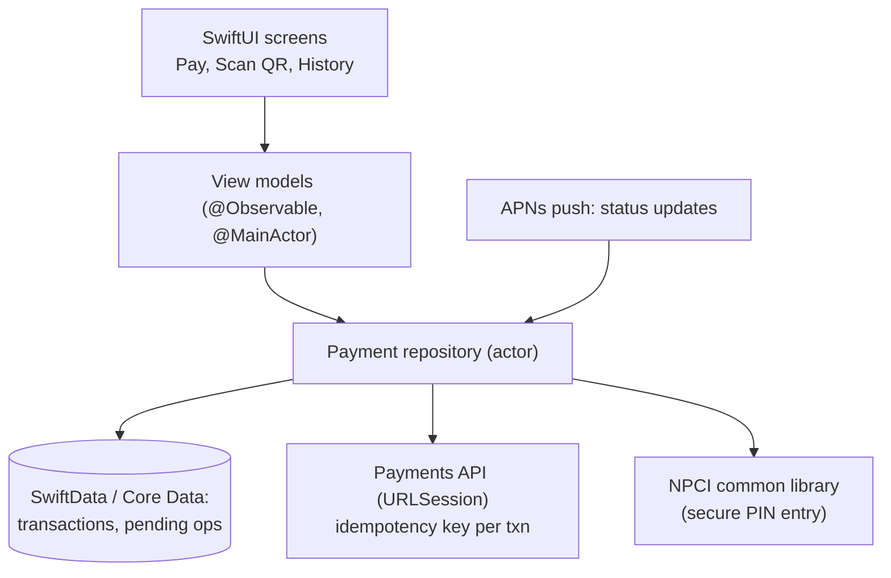
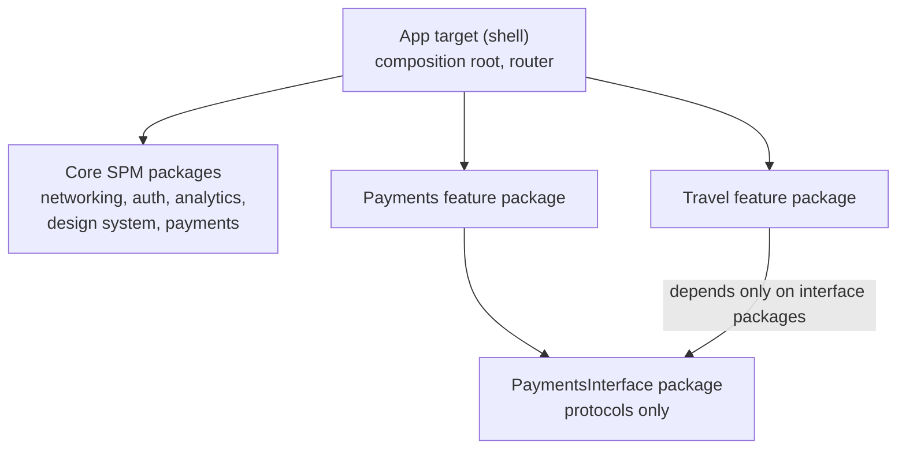

# Company-Wise Questions (Product Companies)

[⬅ Back to index](../README.md)

Covers: how iOS interview loops work at Apple, Google, Meta, Amazon, Microsoft, Uber, Airbnb, Netflix, LinkedIn, Spotify and Indian product companies (Flipkart, Swiggy, Zomato, PhonePe, Paytm, CRED, Meesho, Zepto, Hotstar, Dream11, Razorpay); the machine-coding round; the most-asked questions; and full answers for company-style mobile design prompts (UPI app, quick commerce, live order tracking, super-app, product listing, short-video feed, server-driven UI, live scores, feature-flag SDK).

> These lists come from commonly reported interview experiences. Companies change their questions and loops often, so use them to practise each company's **style**, not as a guaranteed list. Links point to the full answers in this repo. For backend-heavy design rounds, see the [System Design repo](https://github.com/AkshayAshokCode/System-Design-Interview-Questions-cheat-sheet).

---

## How Product Companies Interview iOS Engineers

### 1. What does a typical iOS interview loop at a product company look like?

Answer

Most loops combine some of these rounds:
- **DSA / coding** (1–3 rounds) – data structures and algorithms, usually in Swift. Heaviest at Google, Meta, Amazon, Microsoft.
- **iOS / platform knowledge** – Swift language, memory management, concurrency, UIKit and SwiftUI, app lifecycle, performance, architecture. Often a deep conversation, sometimes with code.
- **Machine coding** – build a small working app or feature in 60–180 minutes. Very common at Indian product companies and startups.
- **Mobile system design** – design an app's client architecture and its contract with the backend (senior and above). See [System Design](20-system-design.md).
- **Behavioral / hiring manager** – past projects, ownership, conflict, impact. See [Coding, Scenarios & Behavioral](22-coding-scenarios.md).

Ask the recruiter for the exact rounds; preparing for the wrong format wastes time.

### 2. What are iOS interviews at Apple like?

Answer

**Format (commonly reported)** – Apple hires per team, so loops vary a lot. Expect several technical conversations with team members, practical coding (often iOS-flavoured, sometimes DSA), deep framework knowledge, and a manager round. Some teams give a take-home or a live app-building exercise.

**What they probe**
- Deep Swift: value vs reference semantics, copy-on-write, protocols and generics, `some`/`any` → [Swift Advanced](02-swift-advanced.md)
- Memory: ARC, retain cycles, weak/unowned → [Memory](03-memory-management.md)
- Concurrency: GCD, actors, `Sendable`, Swift 6 strict concurrency → [GCD](04-gcd-operations.md), [Swift Concurrency](05-swift-concurrency.md)
- UIKit and SwiftUI internals: run loop, rendering, view identity and data flow → [UIKit](09-uikit.md), [SwiftUI](10-swiftui.md)
- **Privacy and security** by design, on-device processing, accessibility → [Security & Privacy](18-security-privacy.md), [Accessibility](24-accessibility-localization.md)
- Performance with Instruments → [Performance](16-performance.md)

**Tip** – show care for user experience, privacy and platform conventions (Human Interface Guidelines); know the latest WWDC changes relevant to the team → [What's New](21-whats-new-trending.md).

### 3. What are iOS interviews at Google like?

Answer

**Format (commonly reported)** – Google's coding rounds are mostly language-agnostic DSA (graphs, trees, dynamic programming), solved in Swift with clean code and complexity analysis. iOS roles add a **domain round** (iOS fundamentals and app design), and senior candidates get **mobile system design** plus a "Googleyness and leadership" round. Google's iOS apps (Gmail, Maps, YouTube, Photos) are large and modular, so architecture and testing at scale come up.

**Common design prompts** – an image loading/caching library, an offline-first app, a Google Photos-style backup client, a YouTube-style video screen → [System Design](20-system-design.md).

### 4. What are iOS interviews at Meta like?

Answer

**Format (commonly reported)** – two **DSA coding** rounds (fast pace: often two problems in 45 minutes), a **mobile system design / product architecture** round, and a **behavioral** round.

**Common design prompts** – the Instagram or Facebook feed, Instagram Stories, Messenger/WhatsApp chat, a photo upload flow, a video feed with prefetching → [System Design](20-system-design.md), [short-video feed](#21-design-a-short-video-feed-like-instagram-reels--moj--sharechat).

**Deep-dive topics** – pagination and caching, image and video prefetching, optimistic updates, offline queues, real-time updates, scroll performance (cell reuse, off-main-thread work), app size and launch time, poor networks.

**Tip** – drive from the product: what the user sees, then data flow, then edge cases (offline, slow network, app suspended/terminated).

### 5. What are iOS interviews at Amazon like?

Answer

**Format (commonly reported)** – DSA rounds, an iOS/technical round, often a **low-level or system design** round, and **Leadership Principles** questions in every round. Prepare 6–8 STAR stories mapped to the principles ("Customer Obsession", "Dive Deep", "Ownership", "Disagree and Commit").

**Topics** – iOS fundamentals and architecture, concurrency, memory, testing, and practical designs like a product page, cart sync across devices, order tracking with notifications and Live Activities. → [Architecture](11-architecture.md), [Testing](17-testing.md), [Background & Notifications](15-background-notifications.md)

### 6. What do Microsoft, LinkedIn, Uber, Airbnb, Netflix and Spotify typically ask?

Answer

- **Microsoft / LinkedIn** – team-dependent mix of DSA, iOS deep dive and design; large-codebase concerns: modularization, build times, feed performance, A/B testing. → [DI & Modularization](12-dependency-injection-modularization.md), [Build & Release](19-xcode-build-release.md)
- **Uber / Lyft / DoorDash** – architecture at scale (Uber's RIBs), location tracking, maps, real-time trip state, Live Activities, reliability on bad networks, feature flags. → [Uber-style design](20-system-design.md), [feature-flag SDK](#23-design-a-feature-flag--experimentation-sdk-for-ios)
- **Airbnb** – server-driven UI, design systems, search and booking flows, deep links. → [server-driven UI](#20-design-server-driven-ui-like-airbnb--swiggy--flipkart)
- **Netflix / Spotify** – AVFoundation playback, offline downloads with FairPlay DRM, background audio, adaptive streaming, CarPlay. → [System Design](20-system-design.md), [Background](15-background-notifications.md)

### 7. What do Indian product companies ask iOS engineers?

Answer

Most run: **machine coding** (build an app in 1–3 hours) → **iOS deep dive** → **mobile HLD/LLD** → **hiring manager / culture**. Some add a DSA round (more common at Flipkart, PhonePe, Razorpay).

| Company | Commonly reported focus and prompts |
|---|---|
| **Flipkart / Meesho / Myntra** | Product listing with filters and infinite scroll, image-heavy screens, app size and launch time → [product listing](#19-design-a-product-listing-page-with-filters-and-infinite-scroll-flipkart--amazon) |
| **Swiggy / Zomato** | Live order tracking with Live Activities, restaurant listing, server-driven UI, cart → [order tracking](#16-design-a-live-order-tracking-screen-swiggy--zomato--uber-eats), [SDUI](#20-design-server-driven-ui-like-airbnb--swiggy--flipkart) |
| **Zepto / Blinkit / Instamart** | Quick-commerce home and cart with per-store inventory → [quick commerce](#15-design-a-quick-commerce-app-zepto--blinkit--instamart) |
| **PhonePe / Paytm / Google Pay / CRED / Razorpay** | UPI flows, Keychain/Secure Enclave security, jailbreak detection, super-app modularization, payment SDKs → [UPI app](#14-design-a-upi-payments-app-client-phonepe--google-pay--paytm), [super-app](#17-design-a-super-app-architecture-paytm--phonepe--tata-neu) |
| **Hotstar / Dream11 / Cricbuzz** | Live scores and streaming for millions, Live Activities, spikes → [live scores](#22-design-a-live-score--fantasy-sports-screen-for-millions-of-concurrent-users) |
| **ShareChat / Moj / Josh / Instagram** | Short-video feed with preloading and smooth playback → [short-video feed](#21-design-a-short-video-feed-like-instagram-reels--moj--sharechat) |

Deep-dive favourites: ARC and retain cycles, GCD vs async/await and actors, SwiftUI state and identity, `UITableView`/`UICollectionView` reuse and diffable data sources, app lifecycle and background modes, Core Data concurrency, method dispatch, protocol-oriented programming.

### 8. What is the machine-coding round and how do you do well in it?

Answer

You build a small working app or feature (60–180 minutes), then walk the interviewer through it. Typical prompts:
- Image gallery / movie list from an API with search, pagination and a detail screen.
- A to-do or notes app with persistence (SwiftData/Core Data or a file).
- A countdown timer or stopwatch that keeps correct time across backgrounding.
- A chat screen UI with a fake socket, or a product listing with filters and a cart.

**How to score well**
1. Clarify scope; build must-haves first.
2. Set up a clean structure fast: MVVM with a service/repository layer, protocols for dependencies (testability), async/await, SwiftUI or UIKit with diffable data sources.
3. Get something working end to end early, then add loading/error/empty states, pagination, image caching, cancellation of in-flight requests.
4. Readable code, no massive view controllers; a few unit tests for the view model if time allows.
5. Keep a template project ready if the company allows it.

See worked examples in [Coding & Scenarios](22-coding-scenarios.md).

### 9. Which iOS questions come up most across product companies?

Answer

A checklist to be able to answer confidently:
1. Struct vs class, value semantics, copy-on-write → [01](01-swift-basics.md), [02](02-swift-advanced.md)
2. ARC, retain cycles in closures and delegates, weak vs unowned → [03](03-memory-management.md)
3. GCD: serial vs concurrent, sync vs async, deadlocks, thread safety → [04](04-gcd-operations.md)
4. async/await, Task, task groups, actors, `@MainActor`, `Sendable`, Swift 6 → [05](05-swift-concurrency.md)
5. Combine basics and when to use it vs async sequences → [06](06-combine.md)
6. App and scene lifecycle, background states, run loop → [08](08-ios-fundamentals.md)
7. UIKit: view controller lifecycle, Auto Layout, cell reuse, diffable data sources → [09](09-uikit.md)
8. SwiftUI: view identity, `@State`/`@Binding`/`@Observable`, data flow, performance → [10](10-swiftui.md)
9. MVVM vs VIPER vs TCA, coordinators, Clean Architecture → [11](11-architecture.md)
10. Dependency injection and modularization with SPM → [12](12-dependency-injection-modularization.md)
11. Networking layer design, Codable, token refresh, caching → [13](13-networking.md)
12. Keychain vs UserDefaults, Core Data/SwiftData concurrency → [14](14-data-persistence.md)
13. APNs flow, silent pushes, BGTaskScheduler, Live Activities → [15](15-background-notifications.md)
14. Launch time, hangs, scrolling performance, Instruments → [16](16-performance.md)
15. Mobile system design: feed, chat, image cache, offline sync → [20](20-system-design.md)

### 10. How do expectations differ for senior and staff iOS engineers?

Answer

- **Mid** – solid Swift and UIKit/SwiftUI fundamentals, clean code, builds features end to end.
- **Senior (L5/E5/SDE 3)** – owns the architecture of a feature area; explains trade-offs (SwiftUI vs UIKit, TCA vs MVVM, Combine vs async/await); designs for offline, performance, accessibility and testability; drives mobile system design rounds; mentors.
- **Staff (L6/E6/Principal)** – shapes the whole app's platform: modularization, build times, release process, observability (crash rate, hangs, MetricKit), large migrations (Objective-C → Swift, UIKit → SwiftUI, Swift 6 concurrency) across many teams, and cross-team influence.

### 11. Product companies vs service companies – how should your preparation differ?

Answer

Product companies focus more on **depth and reasoning** (why, internals, trade-offs), DSA, design rounds and measurable product impact. Service/consulting companies tend to focus on breadth of tools and project experience. For product companies: practise DSA in Swift regularly, go deep on memory, concurrency and SwiftUI internals, practise mobile system design out loud, and prepare stories with numbers ("cut launch time by 40%", "crash-free sessions from 99.2% to 99.8%").

### 12. How do you answer "Tell me about an app or feature you built" (the project deep dive)?

Answer

Structure it like a mini design review:
1. **Context** – the product, users, scale, team size.
2. **Architecture** – draw it: layers, modules (SPM packages), data flow, key frameworks.
3. **Decisions and trade-offs** – e.g. why you adopted SwiftUI incrementally, why actors for a cache, why coordinators for navigation.
4. **A hard problem** – a retain cycle, a hang, a Core Data threading crash, a sync bug – and how you found and fixed it (Instruments, crash logs, data).
5. **Impact** – metrics.
6. **Hindsight** – what you'd change.

Be clear about what **you** did versus the team, and only mention what you can defend in depth.

### 13. What should you do in the last week before a product-company iOS interview?

Answer

- **Days 1–2** – revise the most-asked list (question 9) and the README one-liners.
- **Days 3–4** – one timed DSA session per day in Swift; one machine-coding practice if the company runs that round.
- **Day 5** – a mobile system design mock out loud with a prompt from that company's list.
- **Day 6** – behavioral: 6–8 STAR stories; use the company's app and think about how it's built.
- **Day 7** – light revision and rest.

---

## Company-Style Mobile Design Prompts

### 14. Design a UPI payments app client (PhonePe / Google Pay / Paytm).

Answer

**Requirements** – onboard with phone number and device binding, link bank accounts, pay to a UPI ID / QR code / contact, check balance, history, collect requests, notifications; **secure**, reliable on poor networks, never showing a wrong payment status.

**Deep dives**
- **Device binding** – on iOS, apps can't send SMS silently: the app pre-fills an SMS (`MFMessageComposeViewController`) that the user sends from their SIM to verify the number; rebind on device change.
- **PIN security** – the UPI PIN is entered in the **NPCI common library** UI and encrypted with NPCI keys; the app never sees it. Also: secrets in the **Keychain** (with `ThisDeviceOnly` accessibility), keys in the **Secure Enclave**, Face ID/Touch ID for app unlock via LocalAuthentication, jailbreak detection, **App Attest** for device integrity, hiding sensitive content in the app switcher snapshot.
- **Transaction state** – a client transaction ID before calling the server; show `Pending` on timeouts, update via **APNs** or polling with backoff; never re-initiate with a new ID while one is pending.
- **History** – local store as the source of truth with incremental sync; paginated lists.
- **QR scanning** – AVFoundation / VisionKit `DataScannerViewController`, parse `upi://pay?...`; handle UPI deep links from merchant apps.
- **Reliability** – clear states and receipts; retry only safe operations.

### 15. Design a quick-commerce app (Zepto / Blinkit / Instamart).

Answer

**Requirements** – the catalog and stock depend on the **dark store** serving the user's location; home screen with categories and offers; search; cart; checkout; delivery in ~10 minutes with tracking.

**Client design**
- **Location → store** – resolve the serving store on launch or address change; all catalog calls carry the store ID; cache per store; re-validate the cart when the store changes.
- **Home screen** – largely **server-driven** so merchandising can change without App Store releases; skeleton loading; correctly sized images.
- **Inventory freshness** – show cached data instantly, refresh in the background, and **re-validate the cart** before checkout (out of stock, price changes) with clear UI diffs.
- **Cart** – local persistence for instant updates, synced to the server; debounce quantity changes; optimistic UI.
- **Checkout** – idempotent order creation; Apple Pay or a payment SDK; handle pending payments.
- **Tracking** – see [live order tracking](#16-design-a-live-order-tracking-screen-swiggy--zomato--uber-eats), including a Live Activity.
- **Performance** – very fast launch and first screen; prefetch the home feed; small app size.

### 16. Design a live order tracking screen (Swiggy / Zomato / Uber Eats).

Answer

**Requirements** – order status (placed → accepted → preparing → picked up → arriving → delivered), the partner's live location on a map, ETA, contact options; keep users informed when the app is in the background or locked.

**Design**
- **Foreground** – WebSocket/SSE (`URLSessionWebSocketTask`) or polling as a fallback; reconnect with backoff; fetch a snapshot first on reconnect.
- **Map** – MapKit annotation **animated between updates** (updates every 3–5 s) instead of jumping; route overlay.
- **Background and Lock Screen** – a **Live Activity** (ActivityKit) showing status and ETA on the Lock Screen and in the Dynamic Island, updated by **ActivityKit push notifications** from the server (the app doesn't need to run); regular APNs alerts for key events. Respect Live Activity limits (update budgets, ~8 hours).
- **State** – an order state machine driven by server events with sequence numbers; ignore stale events.
- **Battery and data** – stop the socket when the screen isn't visible; rely on Live Activity pushes in the background.
- **Edge cases** – partner reassignment, cancellation, network loss ("last updated" time), app termination (restore from the saved order ID).

### 17. Design a super-app architecture (Paytm / PhonePe / Tata Neu).

Answer

A super-app hosts many mini-products (payments, recharges, travel, shopping, insurance) built by many teams in one app.

**Key points**
- **Modularization** – SPM packages per feature with separate **interface** packages (protocols, routes) and implementation packages, so teams don't depend on each other's internals; faster incremental builds.
- **Navigation** – a central router with deep-link/route contracts; features register entry points; coordinators.
- **Shared platform** – one design system (SwiftUI components), one networking stack, one analytics/feature-flag SDK, one payments SDK.
- **Binary size and launch** – static vs dynamic linking choices (dynamic frameworks slow launch; prefer static or mergeable libraries), lazy initialisation of each mini-app, launch-time budgets per team; iOS has no on-demand code download, so size discipline matters more than on Android.
- **Server-driven UI** for home and promotions; some companies embed web or React Native mini-apps for release agility (App Store rules forbid downloading native executable code).
- **Governance** – ownership, API review for core packages, per-team performance and crash dashboards.

### 18. How would you reduce launch time for an app with 100M users?

Answer

1. **Measure** – Xcode Organizer launch metrics, MetricKit (`MXAppLaunchMetric`), Instruments App Launch template; segment by device (older devices are the long pole).
2. **Find work before the first frame** – too many dynamic frameworks (dyld loading), `+load`/static initialisers, heavy `didFinishLaunching` (SDK setup), synchronous disk or Keychain reads, large storyboards, synchronous network calls.
3. **Fix**
   - Reduce dynamic frameworks (static linking, mergeable libraries).
   - Defer SDK initialisation until after the first frame or first use.
   - Move I/O off the main thread; lazy-load services.
   - Render the first screen from cache; load the rest progressively.
   - Simplify the first screen's view hierarchy.
4. **Prevent regressions** – launch-time tests in CI (XCTest `XCTApplicationLaunchMetric`), budgets, alerts on MetricKit data.

See [Performance & Instruments](16-performance.md).

### 19. Design a product listing page with filters and infinite scroll (Flipkart / Amazon).

Answer

**Requirements** – search or category results with thousands of products, sort and filters (brand, price, rating), infinite scroll, fast on older devices, add to cart/wishlist from the list.

**Design**
- **API** – `GET /products?query=&filters=&sort=&cursor=&limit=20` with **facets** (filter options with counts); cursor pagination.
- **Pagination** – a view model that loads the next page when the user nears the end (`onAppear` of a threshold item, or `UICollectionViewDataSourcePrefetching`); cancel the in-flight page task when filters change; dedupe items by ID.
- **Filters** – one immutable `FilterState`; changes restart pagination (cancel the old `Task`); debounce rapid changes; restore state after relaunch if useful.
- **UI** – `UICollectionView` with compositional layout + diffable data source, or `LazyVGrid` with stable `id`s; images downsampled (ImageIO thumbnails) and cached; prefetching.
- **Cart/wishlist** – optimistic toggle with rollback; a shared cart store (actor) so all screens agree.
- **Older devices** – smaller images, fewer effects; watch memory warnings.
- **Analytics** – batched impression logging.

### 20. Design server-driven UI (like Airbnb / Swiggy / Flipkart).

Answer

**Why** – change screens (home, offers, landing pages) without App Store releases; consistent across iOS, Android and web; enables experiments.

**Design**
- The server returns a **tree of components** with data (`{type: "carousel", items: [...]}`, `{type: "banner"}`, `{type: "productGrid"}`) plus **actions** (`navigate`, `addToCart`, `openURL`).
- The client decodes into a Swift enum of known component types (with an `unknown` case) and maps each to a native SwiftUI/UIKit view via a registry; **unknown types are skipped** so old app versions never crash.
- **Versioning** – the client sends its supported schema version; the server only sends compatible components.
- **Actions** – a typed action handler (deep links, analytics, mutations), not arbitrary scripting (App Store rules also forbid downloading executable code).
- **Performance** – cache the last layout for instant display; lazy containers with stable IDs.
- **Trade-offs** – flexible but harder to debug and less type-safe; use it for content-driven screens, not complex interactive flows.

### 21. Design a short-video feed (like Instagram Reels / Moj / ShareChat).

Answer

**Requirements** – vertical swipe feed of short videos that start **instantly**, autoplay, like/comment/share, smooth on older devices and variable networks.

**Design**
- **Feed** – a paging vertical `UICollectionView` (or SwiftUI `ScrollView` with `.scrollTargetBehavior(.paging)`); pages fetched with cursors.
- **Player pool** – reuse a small pool of `AVPlayer`s (2–3) attached to visible cells; swap `AVPlayerItem`s rather than creating players per cell.
- **Preloading** – prepare the next 1–3 items (`AVPlayerItem` with `preferredForwardBufferDuration`, or download the first segments into a cache via `AVAssetResourceLoaderDelegate`/a local proxy); show a thumbnail as the first frame.
- **Adaptive streaming** – HLS so quality adapts; start at a lower bitrate for faster start.
- **Lifecycle** – pause on background or when the cell isn't fully visible; configure `AVAudioSession` correctly (respect the silent switch for autoplay).
- **Metrics** – time to first frame, stalls, watch time; batched upload.
- **Memory** – release far-away items; react to memory warnings.

### 22. Design a live score / fantasy sports screen for millions of concurrent users.

Answer

**Requirements** – ball-by-ball scores and fantasy points updating within seconds for millions of users; spikes at toss and key moments; battery- and data-friendly.

**Design**
- **Transport** – a WebSocket/SSE connection while the screen is visible; fall back to **polling a CDN-cached JSON** (the same object for everyone, so the CDN absorbs the load).
- **Payload** – small deltas with a version number; fetch a full snapshot on gaps.
- **Client** – a store (actor or `@Observable` model) exposing match state; observe only while visible; stop updates in the background.
- **Lock Screen** – a **Live Activity** for the live score updated via ActivityKit push notifications (broadcast push channels in iOS 18+ let one push update everyone following a match); APNs alerts for key events (wickets, result).
- **Spikes** – jittered reconnects and backoff; a server-controlled polling interval.
- **Fantasy specifics** – team-lock deadlines enforced by the server; paginated, cached leaderboards.
- **Widgets** – WidgetKit with budgeted timeline reloads.

### 23. Design a feature-flag / experimentation SDK for iOS.

Answer

**Requirements** – teams check flags and experiment variants anywhere; values are available instantly at launch, consistent within a session, updated from the server, and safe when offline.

**Design**
- **Storage** – the last fetched config persisted (file or UserDefaults suite), loaded cheaply at launch, so no flag check waits for the network.
- **Fetch** – refresh in the background at launch and periodically; apply new values on the **next session** or at safe points to avoid UI flipping mid-flow; ETags to skip unchanged configs.
- **Defaults** – compiled-in defaults for every flag; kill switches default to safe values.
- **Experiments** – server-assigned or deterministic hashing of the user ID; log **exposure events** when a variant is actually used.
- **Targeting** – app version, iOS version, country, user segment.
- **Developer experience** – type-safe flag definitions (an enum or generated code), a debug menu to override flags in internal builds, cleanup of stale flags.
- **Thread safety** – an actor or lock-protected store; reads are synchronous and cheap.
- **Why it matters on iOS** – App Store review and phased releases mean a fixed build takes days to reach users; a remote kill switch is often the fastest way to stop a broken feature.

---

[⬅ Previous: Accessibility & Localization](24-accessibility-localization.md) · [⬅ Back to index](../README.md)
